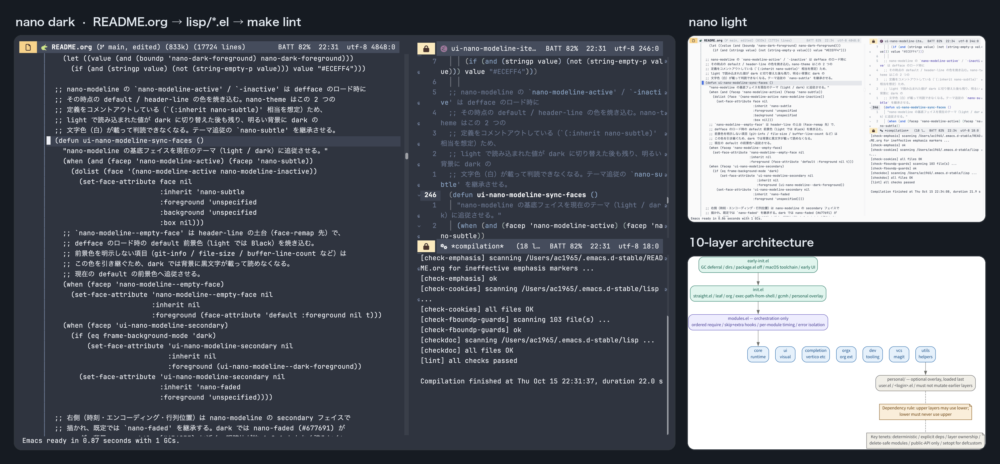
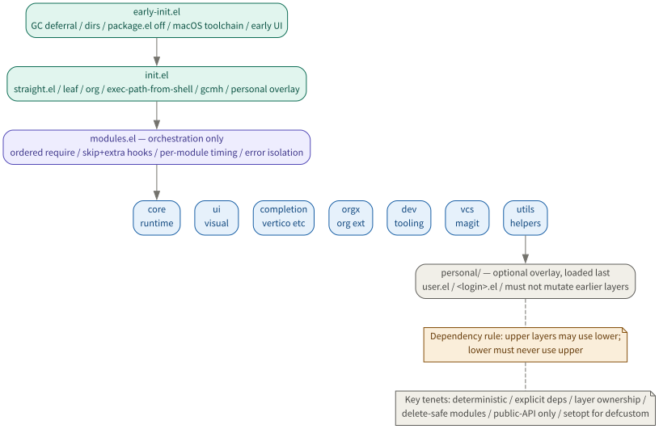
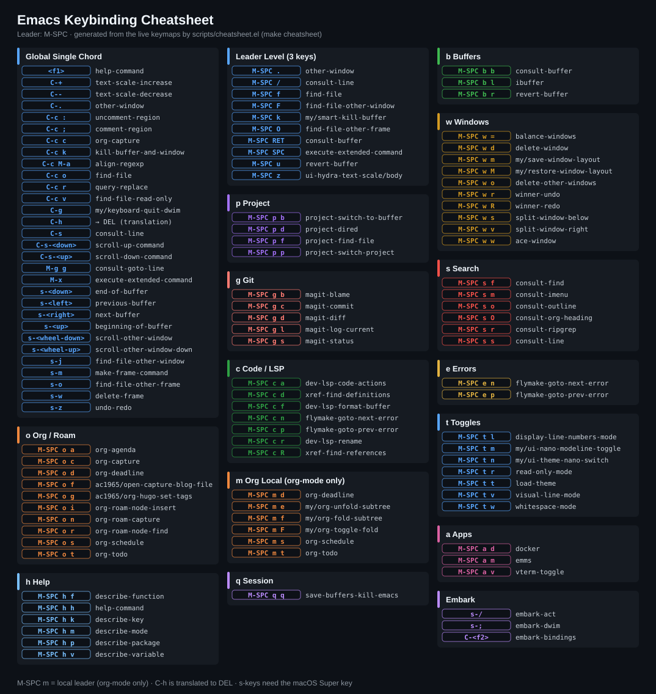

# -*- mode: org; coding: utf-8; -*-
#+TITLE: Modern Emacs Configuration
#+AUTHOR: YAMASHITA, Takao
#+EMAIL: tjy1965@gmail.com
#+LANGUAGE: ja
#+OPTIONS: toc:3 num:t
#+STARTUP: show2levels
#+PROPERTY: header-args :results silent :exports code :mkdirp yes :padline no :tangle no
#+PROPERTY: header-args:emacs-lisp :lexical t :noweb no-export :mkdirp yes :comments no
#+LATEX_COMPILER: lualatex
#+LATEX_CLASS_OPTIONS: [11pt]
#+LATEX_HEADER: \usepackage[a4paper,margin=20mm]{geometry}
#+LATEX_HEADxER: \usepackage{luatexja}
#+LATEX_HEADER: \usepackage{luatexja-fontspec}
#+LATEX_HEADER: \usepackage{newunicodechar}
#+LATEX_HEADER: \usepackage{pifont}
#+LATEX_HEADER_EXTRA: \newfontfamily\EmojiFont{Apple Color Emoji}
#+LATEX_HEADER_EXTRA: \sloppy
#+LATEX_HEADER_EXTRA: \newfontfamily\KeySymbolFont{Apple Symbols}
#+LATEX_HEADER_EXTRA: \ltjdefcharrange{20}{"21A9,"21E5,"21EA,"2303,"2318,"2325,"232B,"238B,"21E7,"2699,"2717,"2B60,"2713}
#+LATEX_HEADER_EXTRA: \ltjsetparameter{jacharrange={-20}}
#+LATEX_HEADER_EXTRA: \newunicodechar{⌘}{{\KeySymbolFont ⌘}}
#+LATEX_HEADER_EXTRA: \newunicodechar{⌥}{{\KeySymbolFont ⌥}}
#+LATEX_HEADER_EXTRA: \newunicodechar{⌃}{{\KeySymbolFont ⌃}}
#+LATEX_HEADER_EXTRA: \newunicodechar{⇧}{{\KeySymbolFont ⇧}}
#+LATEX_HEADER_EXTRA: \newunicodechar{⇪}{{\KeySymbolFont ⇪}}
#+LATEX_HEADER_EXTRA: \newunicodechar{⌫}{{\KeySymbolFont ⌫}}
#+LATEX_HEADER_EXTRA: \newunicodechar{↩}{{\KeySymbolFont ↩}}
#+LATEX_HEADER_EXTRA: \newunicodechar{⎋}{{\KeySymbolFont ⎋}}
#+LATEX_HEADER_EXTRA: \newunicodechar{⇥}{{\KeySymbolFont ⇥}}
#+LATEX_HEADER_EXTRA: \newunicodechar{⚙}{\textbullet}
#+LATEX_HEADER_EXTRA: \newunicodechar{✗}{\ding{55}}
#+LATEX_HEADER_EXTRA: \newunicodechar{✓}{\ding{51}}
#+LATEX_HEADER_EXTRA: \newunicodechar{⭠}{$\leftarrow$}

* Overview
:PROPERTIES:
:CUSTOM_ID: overview
:END:

これは、Org Mode と Babel を使ったリテラルプログラミング方式の Emacs 設定です。

普通の Emacs 設定は =.el= ファイルの集まりですが、この設定では =README.org= と =org/= 配下の
Org 文書がすべての出発点になります。ここに書いたソースブロックが tangle され、 =.el= ファイルとして
書き出されるという仕組みです。

*なぜこの方式なのか*

設定が育つほど、「なぜこう書いたのか」が失われていきます。コメントに残しても、コードと
説明が別々に古びていくのが普通です。説明とコードを同じ節の同じソースブロックに同居させ、
=.el= を生成物と割り切ってしまえば、説明とコードが食い違うこと自体が構造的に起こり
えなくなります。設計の意図を書き残す場所と、実際に動くコードの場所が、同じ一箇所になる
わけです。

この「一箇所」は、ファイル 1 枚ではなく、同じ節のことです。設定の正本は =README.org= と =org/<層>.org= 、
補助スクリプトの正本は =org/tools.org= で、どれも説明とコードを同じ節に置きます。 =.el= と
=scripts/= は、この 2 つの Org 文書から tangle される生成物です。正本が複数の文書に
分かれても、説明をコードから切り離さない限り、この性質は保たれます。

*設計の柱*

- *決定論的な起動* — 同じ入力からは、いつでも同じ結果が得られること
- *明示的な依存関係* — 暗黙の自動探索はしない。何がいつ読まれるかを常に追えること
- *削除しても壊れない構成* — どのモジュールを消しても、残りは動き続けること
- *組み込み優先* — Emacs 31 の組み込み機能があるなら、自作の等価物より必ずそちらを使う
- *長期的な保守性* — 数年単位で育て続けられること
- *LSP バックエンド非依存* — eglot / lsp-mode を差し替え可能にすること（呼び出しは =dev-lsp-bridge= のファサードを通す）

** Clone and First Steps
:PROPERTIES:
:CUSTOM_ID: clone-and-first-steps
:END:

リポジトリは https://github.com/ac1965/.emacs.d です。 =git clone= した直後は
Org 文書（ =README.org= と =org/*.org= ）しか設定の実体がありません。 =early-init.el= 、
=init.el= 、 =lisp/= 、 =personal/= 、 =scripts/= 、 =Makefile= はすべてこれらからの tangle 生成物で、
=.gitignore= 対象だからです。そのため、clone のあとに *tangle する* 作業が必須になります。

1. 既存の =~/.emacs.d= があれば退避してから、clone します。

   #+begin_example
   mv ~/.emacs.d ~/.emacs.d.bak        # 既存の設定がある場合のみ
   git clone https://github.com/ac1965/.emacs.d ~/.emacs.d
   cd ~/.emacs.d
   #+end_example

2. 初回の tangle を行います。この時点では =Makefile= がまだ無いので、 =make= ではなく
   生の Emacs バッチコマンドを使います（理由は [[#tangling][Tangle]] の「初回ブートストラップ」を参照）。

   #+begin_example
   emacs -Q --batch --eval '(require (quote ob-tangle))' \
                     --eval '(dolist (f (append (list "README.org") (directory-files "org" t "[.]org$"))) (org-babel-tangle-file f))'
   #+end_example

3. 以後は =make reload= で再生成します（ =clean= + =tangle= + =check-cookies= ）。

   #+begin_example
   make reload
   #+end_example

4. Emacs を起動する。初回起動は、straight.el による外部パッケージの取得と
   ネイティブコンパイルが走るため、ネットワーク接続が必要で時間もかかります。
   途中でウィンドウが固まったように見えても、終わるまで待ってください。
   起動に失敗した場合は、 =*Messages*= と =*Warnings*= の内容を確認します。

5. 自分用の設定を =personal/= に合わせます。 =personal/user.el= 、 =personal/device-darwin.el=
   などは本人（ac1965）向けの内容を含む tangle 生成物です。そのまま使わず、
   README.org の [[file:org/personal.org::#personal-config][Personal Configuration]] 節にある該当ブロックを自分の環境向けに
   書き換えてから =make reload= してください。 =personal/= 自体を直接編集しても、
   次の tangle で上書きされます。

6. 秘密情報（API キー、パスワード等）は設定に書かず、 =pass= + GnuPG や
   auth-source に置きます（[[#prerequisites][Prerequisites]] の推奨ツールを参照）。

*注意*

- =.var/= は履歴などのランタイム状態です。消すと困るので残します。キャッシュ（ =my:d:cache= 、
  リポジトリの外の =$XDG_CACHE_HOME/emacs/= 、なければ =~/.cache/emacs/= ）は消しても
  自動的に作り直されます。
- 設定を変えるときは、生成物（ =.el= ）ではなく必ず README.org を編集します。

** Emacs Version Numbers
:PROPERTIES:
:CUSTOM_ID: emacs-version-numbers
:END:

Emacs のバージョンは =メジャー.マイナー.リビジョン= の形で表されます。たとえば
=32.0.50= なら、メジャーが 32、マイナーが 0、3 つ目が 50 です。

| 表記             | 意味                                                         |
|------------------+--------------------------------------------------------------|
| =30.1= 、 =31.1= | 安定版のリリース。2 要素で、マイナーが 1 以上になる          |
| =31.0.50=        | 開発版（ =master= ）。次の 31 リリースに向けた開発中の状態   |
| =31.0.90=        | プレテスト版。リリース直前の試験版で、 =.91= 、 =.92= と続く |
| =32.0.50=        | 31 の枝を切ったあとの =master= 。次の次の開発版              |

- *3 つ目が 50* ... 開発版（ =master= ）です。毎日のように変わるので、同じ =32.0.50= でも
  コミットが違えば中身も違います。
- *3 つ目が 90 以上* ... リリース前のプレテストです。90 から始まり、番号が進むほど
  正式版に近づきます。
- *2 要素* （ =31.1= など）... 正式リリースです。 =31.1= の次は、バグ修正版の =31.2= になります。

*本設定が対象とする版*

本設定は Emacs 31 を対象にしており、作者の環境は =32.0.50= （ =master= ）です。
[[#prerequisites][Prerequisites]] の表のとおり、同じ =32.0.50= でもコミットで挙動が変わるため、
問題を報告するときはバージョン番号だけでなくコミットも併記してください。

*自分の Emacs のバージョンを調べる*

#+begin_example
M-x emacs-version
#+end_example

Lisp からは =emacs-major-version= と =emacs-minor-version= で読めます。本設定のバージョン
ガードも、 =(>= emacs-major-version 31)= のようにこれらで判定しています。

** Architecture
:PROPERTIES:
:CUSTOM_ID: architecture
:END:

設定全体は 10 層に分かれています。各層はそれぞれ固有の責務を持ち、依存関係は必ず一方向にしか
流れません。

#+begin_example
layer 10: personal      (ユーザー固有。下位層を変更してはならない)
layer  9: utils         (汎用ユーティリティ)
layer  8: dev           (言語モード、LSP、AI 支援)
layer  7: vcs           (Magit、Forge、diff-hl)
layer  6: orgx          (Org 拡張)
layer  5: completion    (vertico/corfu/consult/embark)
layer  4: auth          (auth-source、EasyPG)
layer  3: ui            (テーマ、フォント、ウィンドウ)
layer  2: core          (ランタイム基盤 + ポリシー)
layer  1: early-init    (package.el の無効化、GC 最適化)
#+end_example

*なぜ層に分けるのか*

Emacs の設定が壊れるときの典型は、「A を直したら、まったく関係ないと思っていた B が動かなく
なった」というパターンです。原因のほとんどは、依存関係が双方向に絡まっていることにあります。

そこで、層の順序を固定し、依存は下向きにしか流さない、というルールを置いています。上の層は
下の層を頼ってかまいませんが、下の層は上の層のことを知りません。これだけで、ある層に手を入れたときの
影響範囲は「その層と、それより上」に収まります。

ロード順は、上の一覧を下（layer 1）から上（layer 10）へたどった順です。これがそのまま依存の向きになります。

ただし personal だけは例外です。依存の向きでは最上位ですが、 =personal/user.el= と
=personal/<ユーザー名>.el= は、先に =my:modules-extra= や各種変数を決めておく必要があります。
そのため =init.el= のステップ 9 で、 =lisp/modules.el= （ステップ 10）より前に読み込まれます。
それ以外の =personal-*.el= は、 =user.el= が必要に応じて読み込みます（Org のロード後やアイドル時など）。

*守るべき不変条件*

- 上位層は下位層に依存してよい
- 下位層は上位層に依存してはならない
- 依存関係の自動探索は行わない
- すべての副作用は明示的である
- LSP バックエンド（eglot / lsp-mode）は =core-switches= で選択する

最後の一つは、この不変条件の効き目がよく分かる例です。 =core= 層にいる =core-switches= は
登録簿だけを持ち、バックエンドの名前を知りません。 =dev= 層の =dev-lsp-bridge= と =ui= 層の
=ui-bundles= が、自分から登録します。下位層から上位層への依存を作らずに切り替えを実現しています。
詳しくは =core-switches.el= の設計ノートを参照してください。

** Directory Layout
:PROPERTIES:
:CUSTOM_ID: directory-layout
:END:

リポジトリの構成は次のとおりです。

#+begin_example
.emacs.d/
├── README.org   (設計と設定の真実の源)
├── org/         (層ごとの真実の源。boot / core / ui / auth / completion / orgx / dev / vcs / utils / personal、補助スクリプトの tools)
├── Makefile     (README.org から tangle される)
├── early-init.el  (org/boot.org から tangle される)
├── init.el        (org/boot.org から tangle される)
├── lisp/
│   ├── modules.el
│   ├── core/
│   ├── ui/
│   ├── auth/
│   ├── completion/
│   ├── orgx/
│   ├── vcs/
│   ├── dev/
│   └── utils/
├── personal/    (ユーザー／デバイス固有のオーバーレイ)
├── scripts/     (lint・リロード・エクスポート・デモ撮影用のヘルパー。tangle 生成物)
├── svg/         (図のソース .dot/.mmd と、描画済みの .svg)
├── .var/        (ランタイム状態)
└── .etc/        (外部リソース)
#+end_example

=README.org= 、 =org/*.org= と =svg/*.svg= 、 =puppeteer-config.json= を除くファイルは、すべてこれらの Org 文書
から tangle される生成物です（ =svg/*.svg= は =make diagrams= で描画してコミットします）。直接編集しても、次の tangle で上書きされます。

| ディレクトリ | 役割 |
|-------------+------|
| =lisp/=     | モジュールのソースコード。 =lisp/modules.el= がローダのエントリポイント |
| =personal/= | ユーザー／デバイスのオーバーレイ（ =modules.el= より前に =init.el= が読み込む） |
| =.var/=     | ランタイム状態（パッケージが書き出すデータ） |
| キャッシュ（ =my:d:cache= ） | 一時キャッシュ。リポジトリの外の =$XDG_CACHE_HOME/emacs/= （なければ =~/.cache/emacs/= ）にあり、削除しても自動的に再生成される |
| =scripts/=  | =check_emphasis.py= などの Python ヘルパー（ =Makefile= から呼ばれる）、デモ画像の撮影スクリプト（ =demo-layout.el= 、 =shot.sh= 、 =compose.py= ）、キーバインド一覧 SVG の生成（ =cheatsheet.el= ） |
| =svg/=      | 図のソース（ =.dot= / =.mmd= ）と描画済みの =.svg= |
| =.etc/=     | no-littering の設定系ファイル（ =custom.el= 等） |

*状態ファイルを 3 つに分ける理由*

=.var/= 、キャッシュ（ =my:d:cache= ）、 =.etc/= を分けているのは、「消していいもの」と「消すと困るもの」を
はっきりさせるためです。キャッシュは消しても自動的に作り直されます。 =.var/= には履歴や
セッションなど、消すと復元できないものが入ります。トラブル時にどこを消せば安全かが、
ディレクトリ名だけで判断できる、という状態を目指しています。

** Layer Definitions
:PROPERTIES:
:CUSTOM_ID: layers
:END:

ここからは各層の責務を順に見ていきます。

*** core

ランタイムの土台です。最下位の機能層で、他のすべての層がこれに依存します。

責務:

- ネイティブコンパイルの警告の収集・診断・報告（ =core-native= 。 =eln-cache= の配置は =early-init.el= ）
- Tree-sitter 文法の管理（ =core-treesit= ）
- 履歴とセッション（ =core-history= ）、古いバックアップの削除（ =core-persistence= ）、
  自動保存とバックアップ（ =core-autosave= ）、編集まわりの既定（ =core-editing= ）
- dired の dirvish への置き換え（ =core-dired= ）
- 明示的な契機での GC（ =core-gc= ）と OS ごとの修飾キー変数・初回フレーム用ヘルパー（ =core-runtime= ）
- custom-file の管理（ =core-custom= ）と LSP/UI バックエンドの選択（ =core-switches= ）

*core に入れないもの*

ディレクトリ構成と =load-path= の構築は、core ではなく =early-init.el= と =lisp/modules.el=
の仕事です。core モジュールがロードされる時点では、これらは既に整っている前提になります。

また、core が ui 層に依存することは禁止です。「見た目のために core をいじる」を許すと、
層の順序が意味を失うためです。

*** policy

グローバルな編集ポリシーです（core 層の一部としてロードされます）。

責務:

- 空白・行末空白のルール
- インデント標準とタブポリシー
- エディタの安全制約（ =require-final-newline= 等）

policy は「どう書くか」を決めるだけの層なので、UI やパッケージ機能を有効化してはいけません。

*** ui

見た目と操作感を担当します。

責務:

- テーマとフォント（テーマは =my:use-ui= で決まる。 =nano= / =doom-nano= なら nano、 =doom= なら
  doom-themes のテーマ、 =none= なら Emacs の既定）
- ウィンドウ挙動
- UI ヘルパーとリーダーキー基盤
- UI バンドル（doom / nano / doom-nano）を =core-switches= の登録簿へ登録する（ =ui-bundles= ）

*** completion

補完フレームワークとミニバッファの使い心地を担当します。

責務:

- ミニバッファ UI（vertico、marginalia）
- ポップアップ補完（corfu、cape）
- 検索とナビゲーション（consult、embark）
- アイコン統合（nerd-icons、kind-icon）
- Org SRC ブロック内での補完統合

*completion-org-src について*

Org のソースブロックの中でも、その言語に応じた補完がほしい — この要求に応えるのが
=completion-org-src= です。ブロックの検出、言語ごとの CAPF 選択、corfu との統合、
orderless フィルタの適用を、 =org-src-mode-hook= に登録する 4 つの関数で協調させています。

*** auth

認証とシークレットの管理です。

責務:

- =auth-source= バックエンドの設定（ =auth-gpg= ）。暗号化された =~/.authinfo.gpg= を先頭に置く
- EasyPG によるファイル暗号化サポート（ =auth-core= ）
- =pass= ベースの資格情報参照（ =auth-core= 。 =pass= が実行ファイルとして存在するときだけ有効）
- 環境変数の検証（ =auth-core= 。確かめるのは =GPG_KEY_ID= だけで、無ければ警告する）
- 診断コマンド（ =my/auth-gpg-verify= 、 =my/auth-gpg-init-template= 、 =my/auth-keychain-verify= ）

auth も ui 層に依存してはいけません。

*Keychain バックエンドの扱い*

macOS では Keychain バックエンド（ =auth-keychain= ）を、 =personal/device-darwin.el= が有効化します
（=auth-keychain-enable= 自体の既定値は =nil= ）。macOS 以外では、このモジュールは何もしません。無効にしたい場合は、モジュールのロード前に personal 層で
=auth-keychain-enable= を上書きしてください。

*** orgx

Org Mode の拡張群です。orgx の全モジュールは =core= 、 =ui= 、 =auth= 、 =completion= のみに
依存し、 =vcs= や =dev= には依存しません。

本層は 14 モジュールで構成されます。 =my:modules= に含まれる正規モジュールは 10 です。
残る 4 つ（ =orgx-typography= 、 =orgx-brain= 、 =orgx-roam-ui= 、 =orgx-citar= ）はオプション
拡張です。このうち =orgx-typography= 、 =orgx-brain= 、 =orgx-citar= は =personal/user.el= が
=my:modules-extra= に宣言します。 =orgx-roam-ui= は tangle されますが、既定では
=my:modules-extra= に含めません（Org を起動時に引き込まないため。理由は当該モジュールと
=personal/user.el= を参照）。

モジュール別の責務:

- =orgx-core= — Org のディレクトリ構成、 =defvar= によるパス変数、アジェンダの
  フォールバック（フェーズ 1: =inbox.org= ）、TODO キーワード、refile ターゲット、
  キャプチャテンプレート（todo / note / journal / meeting。ブログ記事のテンプレートは =orgx-hugo= が追加する）、
  アーカイブ先、 =after-init-hook= によるアジェンダ再構築（フェーズ 2）
- =orgx-agenda= — キャッシュ付き再帰スキャンによる =org-agenda-files= の生成（ =orgx-core= が after-init で呼ぶ）
- =orgx-extensions= — =org-journal= （journal ディレクトリ）、 =org-roam= （DB の
  配置、コネクタ、 =M-x my/org-roam-autosync-enable= で有効にする autosync（起動時には自動で有効にしない）、
  file-hash ガードの advice）、
  =org-download= （画像ディレクトリ）、 =toc-org= 、 =org-cliplink=
- =orgx-visual= — =org-modern= の表示変数（TODO フェイス、リスト／チェックボックス／
  優先度の記号、見出しの星）、アジェンダのグリッド、カスタムフェイス、
  =org-modern-indent= （org-indent 有効時のブロックのブラケット）。設定は
  =after-init-hook= で一度だけ実行し、 =org-modern-mode= は =org-mode-hook= により
  バッファ単位で有効化する
- =orgx-fold= — 折りたたみ／展開／トグルの対話コマンド（ =my/org-fold-subtree= 、
  =my/org-unfold-subtree= 、 =my/org-toggle-fold= ）。組み込みの =org-fold= を用い、
  Emacs 29 未満では =outline-invisible-p= にフォールバックします。キーバインドは
  =M-SPC m= 配下と、 =C-c= のエイリアスです
- =orgx-export= — =markdown-mode= 、
  =markdown-preview-mode =、 =edit-indirect= 、 =ob-mermaid= （Babel の mermaid 言語。
  CLI パスは =orgx-export--mermaid-cli-path= で探索）、 =ob-dot= （Graphviz。
  オプション扱いで、 =ob-dot= が load-path 上にある場合のみ有効化）、LaTeX/PDF
  （ =ltjsarticle= クラスを =org-latex-classes= に登録し、PDF 生成は =latexmk=
  経由で =~/.latexmkrc= の LuaLaTeX-ja デフォルトに委ねる）
- =orgx-notes-markdown= — =my:d:org= 配下のノートブック形式 Markdown ノート。
  =pandoc= をバックエンドとする =markdown-mode= / =gfm-mode= 、 =visual-fill-column= 、
  =consult-notes= 統合（ =consult-notes-file-dir-sources= を =:config= 内の =setopt=
  で設定）、画像用の  =org-download= 統合。コマンドは =my/notes-new-note= 、
  =my/notes-open-root= 、 =my/notes-consult-ripgrep=
- =orgx-auto-tangle= — このリポジトリの Org 文書（ =README.org= と =org/*.org= ）に限り、 =after-save-hook= で =org-babel-tangle=
  を自動実行します。サードパーティの =org-auto-tangle= パッケージは使わず、
  =ob-tangle= を直接呼ぶ独自実装です。再帰ループを防ぐため、バッファローカルな
  実行中フラグでガードしています
- =orgx-hugo= — Hugo ブログ（ =ox-hugo= ）の設定。 =ox-hugo= の導入（TOML フロントマター）、
  =org-export-dispatch= の前に =ox-hugo= を =require= するアドバイス（ =C-c C-e= のメニューに
  Hugo を出すため）、 =org-hugo-export-wim-to-md= の実行中だけ =org-agenda-files= を絞るアドバイス、
  ブログ記事の capture テンプレート "b"。タグの入力を行うかは =orgx-hugo-capture-prompt-tags-p=
  で切り替えます。テンプレートは =orgx-core= の =org= の設定のあとに追加します
- =orgx-auto-hugo= — =org-capture-after-finalize-hook= を契機とする =ox-hugo= の
  全サブツリー・エクスポート（保存時ではなく =C-c C-c= の確定時に発火）。中断された
  キャプチャ（ =org-note-abort= ）はスキップし、対象ファイルは確定時に
  =my:f:capture-blog-file= で判定する（判定は =orgx-auto-hugo-blog-buffer-p= と
  =orgx-auto-hugo-blog-capture-p= の 2 つの述語に集約してあり、 =personal/personal-hugo.el= も使う）。あわせて =org-capture-mode-map= に
  =C-c C-p= を割り当て、確定前のエントリを =markdown-preview-mode= で
  ブラウザプレビューできます（実 content ディレクトリには一切書き込みません）
- =orgx-typography= — =valign-mode= （ピクセル精度のテーブル整列）と
  =org-appear-mode= （強調・リンク・上下付き記号の自動表示）。 =personal/user.el=
  が =my:modules-extra= に追加するオプション拡張
- =orgx-roam-ui= — =simple-httpd= + =websocket= 上で動く =org-roam-ui= グラフ
  ビジュアライザ。依存はトップレベルで =straight-use-package= により導入するのみで、
  =require= はしません（ =org-roam-ui-open= は autoload されるため）。 =simple-httpd= には
  明示的な =:local-repo= を与え、 =web-server= との local-repo 名の衝突を防いでいます。
  =my:modules-extra= に加えた場合、モジュールのロード時に依存を導入し、 =org-roam= の
  ロード後にアイドルタイマー（8 秒）で UI を開きます。ただし既定では、このリストに含めません
- =orgx-brain= — =my:d:org-roam= をノートディレクトリとして共有する =org-brain=
  マインドマップビュー。コマンドは =my/brain-visualize=
- =orgx-citar= — =citar= + =org-cite= による文献引用管理。 =citar-bibliography= は
  =my:d:org-biblio= （ =my:d:org= 配下）を参照し、ホームディレクトリ直書きの
  パスをハードコードしません。 =citar-embark= が =embark-act= 経由の文献アクション
  （開く／挿入など）を追加します

*Org Babel の言語登録について*

明示的に登録しているのは =mermaid= と =dot= （Graphviz、オプション）の 2 つだけで、いずれも
=orgx-export= で行います。 =emacs-lisp= 、 =shell= 、 =python= は Org の組み込みデフォルトなので、
登録は不要です。

*orgx がやらないこと*

補完 CAPF の統合は orgx の責務ではありません。それは =completion= 層（ =completion-org-src= ）
の担当です。Org のための補完だからといって orgx に置くと、層の境界が曖昧に
なってしまいます。

*** vcs

バージョン管理の統合です。

責務:

- 組み込み =vc= のポリシー（ =vcs-core= ）: 非同期チェックイン、公開済み履歴の保護、
  =vc-auto-revert-mode= 、VC Directory の整理（ =vc= の設定は Emacs 31 以降のみ）。
  衝突マーカーを含むファイルでの smerge の自動有効化は、バージョンによらず働く
- Magit の設定（ =vcs-magit= ）: ステータスの全画面表示、 =bury= 時のウィンドウ構成の復元、
  Ediff の制御パネルを別フレームにしない設定
- ガター差分表示（diff-hl）
- GitHub/GitLab の Forge 統合

vcs は dev 層に依存してはいけません。

*** dev

開発ツールです。

責務:

- LSP バックエンド（eglot、lsp-mode）と、その切り替えを吸収するファサード（ =dev-lsp-bridge= ）
- AI 支援編集（aidermacs。 =dev-ai= ）
- ターミナル統合（vterm）
- コード整形（apheleia）
- ビルド・Docker・SQL・REST・インフラ系ファイルのモード・プロジェクト基盤・検索／ナビゲーション
  の補助（ =dev-build= 、 =dev-docker= 、 =dev-sql= 、 =dev-rest= 、 =dev-infra-modes= 、
  =dev-web-core= 、 =dev-navigation= 、 =dev-tools= ）
- デバッガ（dape）・direnv の環境（envrc）・テストの実行（ =dev-run= ）
- radare2 によるバイナリ解析（ =dev-radare2= ）
- EMMS による音楽プレイヤー統合（ =dev-music= ）
- osascript による Apple Music の操作（ =dev-apple-music= 。macOS のみ。 =personal/device-darwin.el= が =my:modules-extra= に加える）
- LSP バックエンドを =core-switches= の登録簿へ登録する（ =dev-lsp-bridge= ）

なお、Org Babel と Claude API を組み合わせたワークフローは =personal/personal-ai.el= にあり、
HTTP 通信は =utils/utils-claude.el= に依存します。AI 関連がすべて dev 層にあるわけではない
点に注意してください。同様に、ローカル Ollama モデルへのルーター（=~/.local/bin/localllm=）を
Org-roam / コーディングバッファの双方から呼び出す統合は =personal/personal-llm.el= にあり、
HTTP クライアントを介さずプロセス起動のみで完結するため =utils= 層には依存しません。

*** utils

層をまたいで使われる汎用ユーティリティです。

モジュール別の責務:

- =utils-buffers= — =my/smart-kill-buffer= （保存してから kill する）
- =utils-edit= — バッファ全体に対する編集コマンド（整形、コピー、行連結）
- =utils-dired= — dirvish/dired ナビゲーションのための =RET= ディスパッチ
- =utils-ime= — macism による入力ソース制御（リーダー／dired・magit-status・ターミナル系／ミニバッファで英字へ、離脱時は自動復帰）
- =utils-functions= — 設定のリロード、 =README.org= を開く、デバッグのトグル
- =utils-lint= — flymake のポリシー。flycheck は lsp-mode の診断バックエンドとしてのみ保持
- =utils-diagnostics= — =load-path= / feature / 外部実行ファイルの点検
- =utils-scratch= — =*scratch*= の自動再生成と複数 scratch バッファ
- =utils-claude= — Claude API の HTTP クライアント（ =personal/personal-ai.el= の通信層）

パス操作と非同期シェルのヘルパーは、2026-07 のデッドコード除去で削除しました（呼び出し箇所が
一つも無かったためです）。ディレクトリ操作の正式なヘルパーは =early-init.el= で定義される
=my/ensure-directory-exists= です。

*** personal

ユーザー固有のカスタマイズです。

- 任意（無くてもシステムは動きます）
- 依存の向きでは最上位です。ただし =user.el= と =<ユーザー名>.el= は =modules.el= より前に読み込まれ、変数の上書きと =my:modules-extra= への追加を行います
- 下位層の関数やモジュールは書き換えません（上書きしてよいのは =defvar= / =defcustom= の値だけです）
- 利用者固有の機能（ =personal-llm= のコマンド、 =personal-messages= の定期実行、 =device-wsl= のクリップボード連携など）は、
  自前のコマンドやフックを持てます。下位層の関数を置き換えず、足すだけにしてください

** Module Structure
:PROPERTIES:
:CUSTOM_ID: module-structure
:END:

どのモジュールも、同じ形をしています。

#+begin_example
;;; module-name.el --- description -*- lexical-binding: t; -*-

;;; Commentary:

責務の説明。

;;; Code:

(require ...)

(defgroup ...)

(defcustom ...)

(defun ...)

(provide 'module-name)

;;; module-name.el ends here
#+end_example

そのうえで、各モジュールは次の 4 つを満たす必要があります。

- *決定論的* — 同じ入力から同じ出力が得られる
- *冪等* — 繰り返し評価しても副作用が重複しない
- *バイトコンパイル下で安全*
- *デーモンモード下で安全*

*** Autoload-Only Modules
:PROPERTIES:
:CUSTOM_ID: autoload-only-modules
:END:

tangle 対象でありながら、意図的に =my:modules= に載せていないモジュールがあります。これらは
調整役のモジュールに書かれた =autoload= 宣言によって、必要になったときだけロードされます。

起動時に無条件でロードしては困る場合 — たとえば LSP バックエンドの選択や、オプションの UI
バンドル — がこれに当たります。使わない方のバックエンドまで読み込んでしまっては、
切り替え可能である意味がありません。

| モジュール          | 宣言元          | 起動条件                                |
|---------------------+-----------------+-----------------------------------------|
| =dev-lsp-eglot=     | =dev-lsp-bridge= | after-init 時、 =my:use-lsp= が =eglot= のとき |
| =dev-lsp-mode=      | =dev-lsp-bridge= | after-init 時、 =my:use-lsp= が =lsp= のとき |
| =ui-doom-modeline=  | =ui-bundles= | after-init 時、 =my:use-ui= が =doom= のとき |
| =ui-nano-modeline=  | =ui-bundles= | after-init 時、 =my:use-ui= が =nano= のとき |
| =ui-doom-nano-modeline= | =ui-bundles= | after-init 時、 =my:use-ui= が =doom-nano= のとき |
| =ui-nano-palette=   | =ui-theme=      | =my:use-ui= が =nano= / =doom-nano= のとき =(require 'ui-nano-palette nil t)= |
| =ui-nano-modeline-items= | =ui-nano-modeline= | =ui-nano-modeline= のロード時に =(require 'ui-nano-modeline-items)= |

これらのモジュールは、 =leaf= 宣言で =:require t= を使ってはいけません。 =autoload= エントリが
load-path 上の可用性を保証してくれるので、そこで =:require t= を書くと、遅延ロードの意味が
無くなってしまいます。

*** Optional Extra Modules

=my:modules= に載っていないモジュールには、もう一つ別の系統があります。 =my:modules-extra=
です。

autoload との違いは、遅延しない点にあります。ローダは =(append my:modules my:modules-extra)=
として両者を連結するので、extra のモジュールも通常のシーケンスの中で require されます。
つまりこれは「遅延ロード」ではなく「オプトイン」の仕組みです。

=personal/user.el= が宣言しているのは次の 5 つです。macOS では、これに加えて =personal/device-darwin.el= が =dev-apple-music= を足します。

| モジュール        | 層    | 目的 |
|-------------------+-------+------|
| =ui-visual-aids=  | ui    | pulsar、hl-todo、rainbow-delimiters、indent-bars |
| =ui-macos=        | ui    | macOS のタイトルバー、タスクバー、コンパイル中のスリープ抑止 |
| =orgx-typography= | orgx  | valign、org-appear |
| =orgx-brain=      | orgx  | org-brain マインドマップビュー |
| =orgx-citar=      | orgx  | citar + org-cite による文献引用管理 |
| =dev-apple-music= | dev   | osascript による Apple Music の操作（macOS のみ。 =personal/device-darwin.el= が加える） |

=orgx-roam-ui= は上の表に含まれません。意図的に =my:modules-extra= から外しています。
このモジュールを有効にすると org-roam-ui がモジュールのロード時に依存を導入し、
=org-roam= → =org= を起動直後に引き込むため、Org の遅延ロードが崩れます。グラフビジュアライザを
常用する場合のみ、 =personal/user.el= の =my:modules-extra= に =orgx-roam-ui= を戻してください。

*なぜ personal 層に置くのか*

これらを =my:modules= ではなく personal 層に置いているのは、表示系や知識グラフ系のツールを
使うかどうかが、共有すべきポリシーではなく個人の好みだからです。そして何より、 =core/= の
モジュールが =ui/= や =orgx/= の feature をロードリストに注入することは、層の原則に真っ向から
反します。

** Package Management
:PROPERTIES:
:CUSTOM_ID: packages
:END:

パッケージはすべて =leaf= マクロで宣言します。

#+begin_example
(leaf vertico
  :straight t
  :custom
  ((vertico-count . 15)))
#+end_example

キーワードの順序は固定です（コーディング規則 4）。順序を守るのは好みの問題ではなく、
=:custom= より前に =:pre-setq= を置く、といった評価順の要請があるためです。

#+begin_example
:straight → :ensure → :after → :require →
:pre-setq → :custom → :bind → :hook → :init → :config
#+end_example

** Tangle
:PROPERTIES:
:CUSTOM_ID: tangling
:END:

Org Babel が Emacs Lisp ブロックを展開し、モジュールファイルとして書き出します。

- 各モジュールは =lisp/<layer>/<module>.el= に tangle されます（正本は =org/<layer>.org= ）
- =README.org= と =org/*.org= は、すべて tangle します（ =make tangle= がまとめて行います）
- ディレクトリは自動で作られます（ =:mkdirp yes= ）

実行方法は次のとおりです。

#+begin_example
1. EMACS=/Applications/Emacs.app/Contents/MacOS/Emacs make -C ~/.emacs.d/ reload   # clean + tangle
2. Emacs を再起動する
#+end_example

*初回ブートストラップ（Makefile が無い場合）*

=Makefile= も =scripts/reload.py= も =early-init.el= / =init.el= / =lisp/= も、すべて
この README.org と =org/*.org= からの tangle 生成物で、 =.gitignore= 対象です。 =git clone= 直後は
どれも存在しません。 =make reload= はおろか、 =python3 scripts/reload.py= すらまだ使えない
「鶏と卵」の状態です。

この状態から抜け出せる、依存ゼロの入口が 1 つあります。組み込み Org だけで完結する、
生の Emacs バッチコマンドです。外部パッケージは要りません。straight や leaf の
ブートストラップより前の段階なので、それらにも依存しません。

#+begin_example
emacs -Q --batch --eval '(require (quote ob-tangle))' \
                  --eval '(dolist (f (append (list "README.org") (directory-files "org" t "[.]org$"))) (org-babel-tangle-file f))'
#+end_example

これを一度実行すれば、 =Makefile= ・ =scripts/reload.py= ・ =lisp/*= 一式が生成されます。 =README.org= だけでは =lisp/= は生成されません。正本が複数の Org 文書に分かれているためです。
以後は通常どおり、 =make reload= （またはこのコマンド単体の再実行）で回せます。

なぜ =tangle= ではなく =reload= を使うのか

=reload= ターゲットは、再 tangle の前に =*.elc= を消してくれます。これが無いと、古い
バイトコンパイル済みモジュールが新しい =.el= を覆い隠したまま動き続け、「ソースには存在しない
はずの警告が出る」という厄介な状態に陥ります。原因の切り分けに時間を溶かしがちなので、
基本的には =reload= を使うのが安全です。

*設定の新旧を行き来したとき*

=tangle= は、書き出すファイルを上書きするだけです。tangle 先でなくなったファイルは消しません。ブランチを切り替えたり、
モジュールを統合・改名したコミットを取り込んだりすると、古い =.el= が =lisp/= に残ります。

そこで、 =reload= の最後の段（ =clean-orphans= ）が、どの Org 文書も tangle しない生成物を削除します。
対象は =lisp/= 、 =personal/= 、 =scripts/= の =.el= 、 =.elc= 、 =.py= 、 =.sh= です。
削除せずに一覧だけ見たいときは、 =make check-orphans= を使います（ =make lint= にも含まれます）。

初回セットアップ（上の =emacs -Q --batch= による tangle のあと）は、 =make reload= を 1 回実行すれば足ります。
その tangle で最新の =Makefile= がすでにできているので、 =reload= の途中で =Makefile= が書き換わることはありません。2 回目は不要です。

2 回目が要るのは、 =git pull= などで =Makefile= の内容が変わる更新を取り込んだときだけです。
=reload= の途中で =Makefile= 自身が書き換わった場合は、新しい =Makefile= でもう一度 =reload= を実行します（自動で再実行されます）。

ただし、取り込む前から手元にある古い =Makefile= には、この仕組みがありません。そのため、 *取り込んだ直後の 1 回目の =make reload= は
=Makefile= を更新するだけ* で終わることがあります。 =[reload]= の表示が =Makefile= の更新だけだったら、もう一度
=make reload= を実行してください。

** Design Principles
:PROPERTIES:
:CUSTOM_ID: design-tenets
:END:

*** Deterministic Behaviour

起動は毎回同じ結果を生まなければなりません。 =my:modules= のリストが、ロード順に関する唯一の
正です。ディレクトリを走査して見つけたものを順不同で読む、といったことはしません。

*** Explicit Dependencies

モジュールは依存関係を明示的に =require= します。暗黙の自動探索は行いません。

*** Layer Ownership

各層は自分の領域だけを所有し、他の層を書き換えません。

*** Delete Safety

モジュールを 1 つ削除しても、システムが壊れてはいけません。これを実際に保証しているのが、
ローダの =condition-case= によるエラー隔離です。あるモジュールの読み込みが失敗しても、
そこで起動が止まることはなく、残りは読み込まれます。失われるのは利便性だけで、正しさは
保たれる、という状態を目指しています。

*** Forward Compatibility

Emacs 31 以降の変更を見越し、 =setopt= 、 =keymap-set= 、 =if-let*= 、 =when-let*= を優先して
使います。

*** Startup Performance

シェル環境変数の取り込みは、必要最小限の変数に絞っています。

*何が遅いのか*

macOS では =exec-path-from-shell= がログインシェルを起動して =exec-path= とプロセス環境を
組み立てます。このシェル起動そのものに、およそ 200〜500 ms かかります。設定全体の起動時間に
対して、これは無視できない比率です。

*どう抑えているか*

1. =exec-path-from-shell-arguments= を ='("-l")= （ログインシェルのみ、対話フラグなし）に
   しています。既定の ='("-l" "-i")= と比べ、対話シェルの起動ファイル読み込みを省けるぶん、
   起動時間はおよそ半分になります。

2. =exec-path-from-shell-variables= を =("PATH" "LANG")= だけに絞っています。API キー
   （ =OPENAI_API_KEY= 、 =OPENROUTER_API_KEY= ）は、 =utils-claude.el= の中で必要になった時点で
   =auth-source= 経由で =~/.authinfo.gpg= から取得します。

2 番目が効くのは、これらのキーを export しているログインプロファイルを読み込む理由が、
そもそも無くなるからです。結果として =exec-path-from-shell= のコストは、最小構成のログイン
シェルを起動するという、削りようのない部分だけになります。

** Coding Rules
:PROPERTIES:
:CUSTOM_ID: conventions
:END:

要点だけ挙げると次のとおりです。

- すべてのファイルは lexical binding を宣言し、 =provide= のシンボルはファイル名と一致させる
- 組み込みパッケージには =:straight nil= を使う
- =leaf= のキーワード順序を守る
- 公開 =defun= には必ず docstring を付ける
- =defcustom= には =setopt= 、 =defvar= には =setq= を使う
- 命名規約（ =my/= 、 =<module>-= 、 =<module>--= 、 =my:d:*= ）を守る
- キーバインドは =keymap-set= API（Emacs 29 以降）を使う

詳細は [[file:org/boot.org::#modular-loader-and-core-suite][Modular Loader & Core Suite]] を参照してください。

** License
:PROPERTIES:
:CUSTOM_ID: license
:END:

本設定は GNU General Public License v3 の下で公開されています。詳細は LICENSE ファイルを
参照してください。LICENSE 自身も本文書からの tangle 生成物です（下のソースブロックを、
=make tangle= が =early-init.el= などと同様に書き出します）。正本は常に本節です。

#+begin_src text :tangle LICENSE :mkdirp no :padline no
This program is free software: you can redistribute it and/or modify
it under the terms of the GNU General Public License as published by
the Free Software Foundation, either version 3 of the License, or
(at your option) any later version.

This program is distributed in the hope that it will be useful,
but WITHOUT ANY WARRANTY; without even the implied warranty of
MERCHANTABILITY or FITNESS FOR A PARTICULAR PURPOSE. See the
GNU General Public License for more details.

You should have received a copy of the GNU General Public License
along with this program. If not, see https://www.gnu.org/licenses/.

The complete text of the GNU General Public License version 3 can be found at:
https://www.gnu.org/licenses/gpl-3.0.txt
#+end_src

* Installation
:PROPERTIES:
:CUSTOM_ID: installation
:END:

** Prerequisites
:PROPERTIES:
:CUSTOM_ID: prerequisites
:END:

*必須*

- Emacs 31（ =emacs-31= ブランチ / =master= ）。ネイティブコンパイルを有効にしてビルドして
  ください。2026-10 時点の最新の安定版は Emacs 31.1 です（ ftp.gnu.org の配布ファイルは
  2026-08-24 付け）。直前の系列は 30.x（最新は 30.2）です。
- Git
- GNU Make
- GCC 10 以上（ =libgccjit= ）

*推奨*

- ripgrep（ =rg= ）
- aspell または hunspell
- pass + GnuPG
- Homebrew（macOS）

*Emacs 30 でも動くのか*

動きます。Emacs 31 固有のコードは、すべて  =(>= emacs-major-version 31)= か =boundp= /
=fboundp= でガードしてあります。31 の新機能が使えないぶん機能は落ちますが、設定が壊れる
ことはありません。削除安全性という考え方を、モジュールだけでなく Emacs のバージョンにも
適用している、と考えてください。

*ビルド情報*

# build-info:begin（scripts/update_build_info.py が、この 2 行の間を書き換える。手で編集しない）
- GNU Emacs *32.0.50*

|Property|Value|
|--------|-----|
|Commit|078edfd6455aa1bd65ae93b97222a9bb4f073428|
|Branch|master|
|System|aarch64-apple-darwin27.0.0|
|Date|2026-10-29 00:13:14 (JST)|
|Patch|N/A ns-inline.patch|
|Features|ACL DBUS GIF GLIB GMP GNUTLS JPEG LCMS2 LIBXML2 MODULES NATIVE_COMP NOTIFY KQUEUE NS PDUMPER PNG RSVG SQLITE3 THREADS TIFF TOOLKIT_SCROLL_BARS TREE_SITTER WEBP XIM ZLIB|
|Options|CC=/Applications/Xcode.app/Contents/Developer/Toolchains/XcodeDefault.xctoolchain/usr/bin/clang CXX=/Applications/Xcode.app/Contents/Developer/Toolchains/XcodeDefault.xctoolchain/usr/bin/clang++ AR=/Applications/Xcode.app/Contents/Developer/Toolchains/XcodeDefault.xctoolchain/usr/bin/ar RANLIB=/Applications/Xcode.app/Contents/Developer/Toolchains/XcodeDefault.xctoolchain/usr/bin/ranlib NM=/Applications/Xcode.app/Contents/Developer/Toolchains/XcodeDefault.xctoolchain/usr/bin/nm --with-ns --with-native-compilation=aot --with-tree-sitter --with-gnutls --without-imagemagick --with-modules --prefix=/Users/ac1965/.local 'CFLAGS=-O3 -arch arm64 -isysroot /Applications/Xcode.app/Contents/Developer/Platforms/MacOSX.platform/Developer/SDKs/MacOSX.sdk' 'CPPFLAGS=-I/opt/homebrew/opt/libgccjit/include -isysroot /Applications/Xcode.app/Contents/Developer/Platforms/MacOSX.platform/Developer/SDKs/MacOSX.sdk -I/opt/homebrew/include' 'LDFLAGS=-L/opt/homebrew/opt/libgccjit/lib -isysroot /Applications/Xcode.app/Contents/Developer/Platforms/MacOSX.platform/Developer/SDKs/MacOSX.sdk -L/opt/homebrew/lib -framework AppKit'|
# build-info:end

上の表は、 =my/print-build-info= （ =lisp/dev/dev-tools.el= ）の出力です。Emacs を再ビルドしたら、
貼り付け直さずに、ビルドスクリプトの後でスクリプトを 1 つ実行すれば反映できます。

[[https://github.com/ac1965/dotfiles][dotfiles]] の
[[https://github.com/ac1965/dotfiles/blob/master/.local/bin/build-emacs-macos.sh][build-emacs-macos.sh]]
で Emacs をビルド・インストールした後に、次を実行します。

#+begin_example
python3 scripts/update_build_info.py
git diff README.org   # 差分を確認してコミットする
#+end_example

- 再ビルドした Emacs（既定は =/Applications/Emacs.app/Contents/MacOS/Emacs= ）で =my/print-build-info=
  を実行し、 =# build-info:begin= と =# build-info:end= の間だけを置き換えます。
- =lisp/dev/dev-tools.el= を読み込むため、 =make tangle= （または =make reload= ）の後に実行します。
- 書き換えずに確かめるには =--dry-run= 、最新かどうかだけを調べるには =--check= を付けます。
  詳細は org/tools.org の Appendix: update_build_info.py を参照してください。

* Configuration
:PROPERTIES:
:CUSTOM_ID: structure
:END:

ここからは実装です。設定は *Emacs 31* を対象としたモジュール設計になっています（Emacs 30
でも、機能を落としつつ安全に動きます）。

各層が明確な責務を持つことで、挙動が予測しやすくなり、UI を差し替えられるようになり、個人
向けのカスタマイズを他から隔離できるようになります。ファイルの役割を大づかみに整理すると
次のとおりです。

- =early-init.el= → 最初期のブートストラップ（性能、パス、UI の初期値）
- =init.el=       → パッケージのブートストラップ、グローバル既定値、モジュールのエントリポイント
- =lisp/=         → 共有されバージョン管理されるモジュール群（core, ui, completion, orgx, dev, vcs, utils）
- =personal/=     → ユーザー／デバイス固有のオーバーレイ（共有ポリシーではない）

** 正本の構成
:PROPERTIES:
:CUSTOM_ID: source-files
:END:

実装の正本は、層ごとの Org 文書に分かれています。 =README.org= は設計と索引、 =org/tools.org= は補助スクリプト、
=org/= 配下が各層のモジュールです。どの文書も、説明とコードを同じ節に同居させ、 =make tangle= が
すべてを tangle します。

| 文書 | 内容 |
|------+------|
| [[file:org/boot.org][org/boot.org]] | =early-init.el= 、 =init.el= 、 =lisp/modules.el= |
| [[file:org/core.org][org/core.org]] | core 層（ =lisp/core/= ） |
| [[file:org/ui.org][org/ui.org]] | ui 層（ =lisp/ui/= ） |
| [[file:org/auth.org][org/auth.org]] | auth 層（ =lisp/auth/= ） |
| [[file:org/completion.org][org/completion.org]] | completion 層（ =lisp/completion/= ） |
| [[file:org/orgx.org][org/orgx.org]] | orgx 層（ =lisp/orgx/= ） |
| [[file:org/dev.org][org/dev.org]] | dev 層（ =lisp/dev/= ） |
| [[file:org/vcs.org][org/vcs.org]] | vcs 層（ =lisp/vcs/= ） |
| [[file:org/utils.org][org/utils.org]] | utils 層（ =lisp/utils/= ） |
| [[file:org/personal.org][org/personal.org]] | =personal/= （ユーザー／デバイス固有） |
| [[file:org/tools.org][org/tools.org]] | =scripts/= の補助スクリプト |

この =README.org= には、設計、インストール、 =Makefile= 、図のソース、 =Changelog= が残っています。

* Makefile
:PROPERTIES:
:CUSTOM_ID: makefile
:END:

#+begin_src makefile :tangle Makefile :mkdirp no :padline no
  # Makefile — モジュール式 Emacs 設定のためのワンパス・ビルダー
  # - 既定 / `make all` : onepass-init（tangle -> 差分バイトコンパイル）
  # - `make onepass-q`  : -Q（最小環境）で tangle -> 全バイトコンパイル
  # - パスはリポジトリルートから絶対化する（"lisp/personal" の混同を防ぐため）

  SHELL := /bin/sh

  # ---- リポジトリルートと絶対化したディレクトリ -----------------------------------
  ROOT := $(CURDIR)

  EMACS  ?= emacs
  ORG    ?= README.org
  EARLY  ?= early-init.el
  INIT   ?= init.el
  RSVG_CONVERT ?= rsvg-convert
  DOT    ?= dot
  MMDC   ?= mmdc
  # mmdc が同梱の Chrome を解決できない環境向け。puppeteer 用の JSON 設定ファイルへの
  # パスを渡すと `mmdc -p $(PUPPETEER_CONFIG)` として使われる。空なら渡さない。
  #   例: {"executablePath": "/path/to/chrome", "args": ["--no-sandbox"]}
  # リポジトリ直下に puppeteer-config.json があれば自動採用する（$(wildcard ...) は
  # ファイルが無ければ空文字になるので、無い環境では今まで通り渡さずフォールバックする）。
  # コマンドラインで PUPPETEER_CONFIG=... を指定すれば ?= なのでいつでも上書きできる。
  PUPPETEER_CONFIG ?= $(wildcard puppeteer-config.json)

  # これらは常にリポジトリルート直下として扱う
  LISPDIR_REL     ?= lisp
  PERSONALDIR_REL ?= personal
  SVGDIR_REL      ?= svg

  LISPDIR     := $(abspath $(ROOT)/$(LISPDIR_REL))
  PERSONALDIR := $(abspath $(ROOT)/$(PERSONALDIR_REL))
  SVGDIR      := $(abspath $(ROOT)/$(SVGDIR_REL))
  ORG := $(abspath $(ROOT)/$(ORG))
  # 層別の Org 文書と補助スクリプト（org/*.org。tools.org を含む）。README.org とあわせてすべて tangle・検査する。
  LAYER_ORGS := $(sort $(wildcard $(ROOT)/org/*.org))
  EXTRA_ORGS := $(wildcard $(ROOT)/tools.org) $(LAYER_ORGS)
  ALL_ORGS   := $(ORG) $(EXTRA_ORGS)
  EARLY := $(abspath $(ROOT)/$(EARLY))
  INIT  := $(abspath $(ROOT)/$(INIT))

  STRICT_BYTE_WARN ?= 0   # Treat byte-compile warnings as errors
  NATIVE_COMPILE   ?= 1   # Prefer native-compile if available

  # ---- Emacs の実行方法と共通の eval スニペット -----------------------------------
  EMACS_BATCH := "$(EMACS)" --batch
  EMACS_Q     := $(EMACS_BATCH) -Q

  EVAL_STRICT := $(if $(filter 1,$(STRICT_BYTE_WARN)),--eval "(setq byte-compile-error-on-warn t)",)
  EVAL_NATIVE := $(if $(filter 1,$(NATIVE_COMPILE)),--eval "(setq comp-deferred-compilation t)",)

  # org-babel-tangle は既定で各ソースブロックの「共通の先頭空白」を列（column）単位で
  # 計算して取り除く。この計算はタブをいったんスペースへ展開してから行うため、この
  # ブロックの recipe 行（先頭がタブ 1 文字）はタブが tab-width 分のスペース列へ展開
  # されたうえで共通分だけが差し引かれ、結果として recipe 行の先頭がタブではなく
  # 半端なスペース列に化けてしまう（Make が "missing separator" で落ちる原因）。
  # org-src-preserve-indentation を非 nil にして、この先頭空白の除去処理自体を
  # 無効化し、ソースに書かれたタブをタブのまま出力させる。
  #
  # 注意: .RECIPEPREFIX（GNU Make 3.82+ の機能）で recipe 先頭マーカーをタブ以外の
  # 文字に変える案も検討したが、macOS 標準の /usr/bin/make は GPLv3 回避のため
  # 3.81 に固定されており .RECIPEPREFIX を認識しない。タブそのものを使う今の方式は
  # Make のバージョンに依存しない。
  EVAL_PRESERVE_INDENT := --eval "(setq org-src-preserve-indentation t)"

  # ---- 既定ターゲット（引数なし）--------------------------------------------------
  .PHONY: all onepass-init onepass-q clean distclean distclean-deps show-files echo-paths tangle reload check-cookies check-tangle check-emphasis figures clean-figures dot-tangle dot-svg mmd-tangle mmd-svg diagrams clean-diagrams help
  all: onepass-init

  # ---- ワンパス（early+init 環境）: tangle -> 差分コンパイル -----------------------
  onepass-init: $(ORG)
	@echo "[onepass-init] tangle -> incremental byte-compile (init loaded)"
	@$(EMACS_BATCH) -l "$(EARLY)" -l "$(INIT)" \
  	  $(EVAL_STRICT) $(EVAL_NATIVE) \
  	  --eval "(setq org-confirm-babel-evaluate nil)" \
  	  --eval "(require 'org)" \
  	  --eval "(org-babel-tangle-file \"$(ORG)\")" \
  	  $(foreach f,$(EXTRA_ORGS),--eval "(org-babel-tangle-file \"$(f)\")") \
  	  --eval "(let ((org-src-preserve-indentation t)) (org-babel-tangle-file \"$(ORG)\" nil \"makefile\"))" \
  	  --eval "(let* ((dirs (delq nil (list (and (file-directory-p \"$(LISPDIR)\") \"$(LISPDIR)\") \
  	                                        (and (file-directory-p \"$(PERSONALDIR)\") \"$(PERSONALDIR)\"))))) \
  	            (dolist (d dirs) (byte-recompile-directory d 0)) \
  	            (when (and (featurep 'comp) (bound-and-true-p comp-deferred-compilation)) \
  	              (dolist (d dirs) (ignore-errors (native-compile-async d 'recursively)))))" \
  	  --eval "(message \"[onepass-init] done\")"

  # ---- onepass-q 専用: -Q 実行時の leaf の任意注入 --------------------------------
  # -Q（init.el を読まない最小環境）は straight 経由でインストールした leaf /
  # leaf-keywords を自動では load-path に乗せない。onepass-q はこれを手動で
  # 注入するため、ここで STRAIGHT_BASE_DIR / LEAF_DIR / LEAFKW_DIR / EVAL_LEAF
  # を解決する。
  #
  # スコープの注記: この一連の変数を参照するのは onepass-q・echo-paths・
  # distclean-deps だけである。reload（= clean tangle check-cookies）・
  # tangle 単体・clean はいずれも参照しない。STRAIGHT_BASE_DIR /
  # MY_D_CACHE_DIR は再帰展開変数（?=）なので、$(shell ...) はどこかの
  # ターゲットが実際にこの変数を参照したときにのみ評価される — 参照されなければ、
  # straight や leaf が未インストールの環境で `make reload` 等を実行しても
  # この行が原因で失敗することはない。
  #
  # 注意（$XDG_CACHE_HOME）: early-init.el の my:d:cache は
  # `$XDG_CACHE_HOME/emacs/`（未設定時は `$HOME/.cache/emacs/`）に解決され、
  # straight-base-dir にはこの my:d:cache がそのまま渡る（straight.el 自身が
  # その配下に `straight/` を作る）。以前はここで straight-base-dir の値を
  # そのまま「straight ディレクトリそのもの」として使っており、`straight/`
  # の一段が欠落していた（LEAF_DIR / LEAFKW_DIR が実際には存在しないパスを
  # 指し、onepass-q の leaf 注入が静かに失敗する不具合があった）。また未束縛時
  # フォールバックも $XDG_CACHE_HOME を無視して $HOME/.emacs.d/straight に
  # 固定されていた。両方とも my:d:cache の定義（early-init.el 3) 基本ディレクトリ
  # 参照）に合わせて修正済み。
  STRAIGHT_BASE_DIR ?= $(shell \
    if [ -f "$(EARLY)" ]; then \
      $(EMACS_Q) -l "$(EARLY)" \
        --eval "(princ (expand-file-name \"straight\" \
                         (if (boundp 'straight-base-dir) straight-base-dir user-emacs-directory)))"; \
    else \
      printf "%s" "$${XDG_CACHE_HOME:-$$HOME/.cache}/emacs/straight"; \
    fi)
  LEAF_DIR   := $(STRAIGHT_BASE_DIR)/repos/leaf.el
  LEAFKW_DIR := $(STRAIGHT_BASE_DIR)/repos/leaf-keywords.el

  # MY_D_CACHE_DIR : early-init.el の my:d:cache（straight-base-dir の親であり、
  # eln-cache や一部パッケージ（dirvish 等）のキャッシュも同居する、この設定専用の
  # XDG キャッシュルート）。distclean-deps が実キャッシュ全体を一括削除するために
  # 使う。STRAIGHT_BASE_DIR から逆算せず、my:d:cache を直接問い合わせる（両者の
  # 親子関係という前提に依存しないため）。
  MY_D_CACHE_DIR ?= $(shell \
    if [ -f "$(EARLY)" ]; then \
      $(EMACS_Q) -l "$(EARLY)" \
        --eval "(princ (if (boundp 'my:d:cache) my:d:cache \
                          (expand-file-name \"emacs\" \
                            (or (getenv \"XDG_CACHE_HOME\") \
                                (expand-file-name \".cache\" (getenv \"HOME\"))))))"; \
    else \
      printf "%s" "$${XDG_CACHE_HOME:-$$HOME/.cache}/emacs"; \
    fi)

  EVAL_LEAF := \
    --eval "(let* ((ldir \"$(LEAF_DIR)\") (kwdir \"$(LEAFKW_DIR)\")) \
              (when (file-directory-p ldir)  (add-to-list 'load-path ldir)) \
              (when (file-directory-p kwdir) (add-to-list 'load-path kwdir)) \
              (ignore-errors (require 'leaf)) \
              (ignore-errors (require 'leaf-keywords)) \
              (when (featurep 'leaf-keywords) (leaf-keywords-init)))"

  # ---- ワンパス（-Q 最小環境）: tangle -> 全コンパイル -----------------------------
  onepass-q: $(ORG)
	@echo "[onepass-q] -Q tangle -> full byte-compile (init not loaded)"
	@$(EMACS_Q) \
  	  $(EVAL_LEAF) $(EVAL_STRICT) $(EVAL_NATIVE) \
  	  --eval "(setq org-confirm-babel-evaluate nil)" \
  	  --eval "(require 'org)" \
  	  --eval "(org-babel-tangle-file \"$(ORG)\")" \
  	  $(foreach f,$(EXTRA_ORGS),--eval "(org-babel-tangle-file \"$(f)\")") \
  	  --eval "(let ((org-src-preserve-indentation t)) (org-babel-tangle-file \"$(ORG)\" nil \"makefile\"))" \
  	  --eval "(let* ((dirs (delq nil (list (and (file-directory-p \"$(LISPDIR)\") \"$(LISPDIR)\") \
  	                                        (and (file-directory-p \"$(PERSONALDIR)\") \"$(PERSONALDIR)\"))))) \
  	            (dolist (d dirs) (byte-recompile-directory d t)) \
  	            (when (and (featurep 'comp) (bound-and-true-p comp-deferred-compilation)) \
  	              (dolist (d dirs) (ignore-errors (native-compile-async d 'recursively)))))" \
  	  --eval "(message \"[onepass-q] done\")"

  # ---- ユーティリティ -------------------------------------------------------------
  show-files:
	@echo "[list] $(LISPDIR)";    { [ -d "$(LISPDIR)" ] && find "$(LISPDIR)" -type f -name '*.el' | sort; } || true
	@echo "[list] $(PERSONALDIR)"; { [ -d "$(PERSONALDIR)" ] && find "$(PERSONALDIR)" -type f -name '*.el' | sort; } || true

  echo-paths:
	@echo "ROOT=$(ROOT)"; \
  	echo "EARLY=$(EARLY)"; \
  	echo "INIT=$(INIT)"; \
  	echo "LISPDIR=$(LISPDIR)"; \
  	echo "PERSONALDIR=$(PERSONALDIR)"; \
  	echo "SVGDIR=$(SVGDIR)"; \
  	echo "STRAIGHT_BASE_DIR=$(STRAIGHT_BASE_DIR)"; \
  	echo "LEAF_DIR=$(LEAF_DIR)"; \
  	echo "LEAFKW_DIR=$(LEAFKW_DIR)"; \
  	echo "MY_D_CACHE_DIR=$(MY_D_CACHE_DIR)"

  clean:
	@echo "[clean] remove *.elc under $(LISPDIR) and $(PERSONALDIR)"
	@{ [ -d "$(LISPDIR)" ] && find "$(LISPDIR)" -type f -name '*.elc' -delete; } 2>/dev/null || true
	@{ [ -d "$(PERSONALDIR)" ] && find "$(PERSONALDIR)" -type f -name '*.elc' -delete; } 2>/dev/null || true

  # distclean は README.org からの tangle 生成物一式を削除し、fresh clone 相当に戻す。
  # 対象は早期に消えても実害のない「ソースから常に再生成できるもの」だけ（early-init.el
  # / init.el / lisp/ / personal/ / scripts/ / LICENSE / Makefile 自身、および svg/ 配下の
  # *.dot / *.mmd / *.pdf 中間生成物）。svg/*.svg は git 管理下の成果物なので対象外。
  # ChangeLog も README.org の Changelog 節から tangle される生成物（GNU 形式）で、
  # 常に再生成できるため distclean の対象。
  # straight/ の package clone や eln-cache 等の依存物・実行時キャッシュは distclean には
  # 含めない（再取得・再コンパイルに数分〜かかり、distclean を打つたびに発生させたくない
  # ため）。それらを消したい場合は distclean-deps を使う。
  #
  # 注意: Makefile 自身も削除されるため、実行後は make が一切使えなくなる。再び使うには
  # Tangle 節の「初回ブートストラップ」コマンド（emacs -Q --batch tangle）が必要。
  distclean: clean
	@echo "[distclean] remove stray *.eln"
	@find "$(ROOT)" -type f -name '*.eln' -delete
	@echo "[distclean] remove tangle-generated files (early-init.el init.el lisp/ personal/ scripts/ LICENSE svg intermediates)"
	@rm -f "$(EARLY)" "$(INIT)" "$(ROOT)/LICENSE"
	@rm -rf "$(LISPDIR)" "$(PERSONALDIR)" "$(ROOT)/scripts"
	@{ [ -d "$(SVGDIR)" ] && find "$(SVGDIR)" \( -name '*.dot' -o -name '*.mmd' -o -name '*.pdf' \) -delete; } 2>/dev/null || true
	@echo "[distclean] remove ChangeLog (tangled from README.org Changelog section)"
	@rm -f "$(ROOT)/ChangeLog"
	@echo "[distclean] remove Makefile (re-bootstrap: see README.org Tangle section)"
	@rm -f "$(ROOT)/Makefile"

  # distclean-deps は distclean よりさらに踏み込んだ、破壊的な操作。straight/ のパッケージ
  # clone・ネイティブコンパイルキャッシュ・no-littering の実行時状態を削除する。再取得や
  # 再コンパイルに数分〜十数分かかりうるため distclean には含めず、独立したターゲットに
  # している。
  #
  # 実キャッシュ（straight/ の package clone・eln-cache）は $XDG_CACHE_HOME/emacs/
  # （未設定時は $HOME/.cache/emacs/）配下にあり、$(ROOT) の外なので $(MY_D_CACHE_DIR)
  # を使って削除する（$(ROOT)/straight や $(ROOT)/.cache ではない — 以前はここが
  # 誤っており、$XDG_CACHE_HOME を考慮していなかった）。$(ROOT)/eln-cache は
  # dot-tangle 等の `-Q` バッチ実行が early-init.el を経由せず作る別物の副産物
  # （$HOME/.emacs.d が本リポジトリへのシンボリックリンクであるため、-Q の既定
  # user-emacs-directory がここを指す）なので、これも別途削除する。$(ROOT)/.etc /
  # $(ROOT)/.var（no-littering-etc-directory / -var-directory）はリポジトリ直下
  # のままなので従来どおり。
  distclean-deps:
	@echo "[distclean-deps] remove $(MY_D_CACHE_DIR) (straight/ + eln-cache/ + other per-package caches under XDG_CACHE_HOME)"
	@rm -rf "$(MY_D_CACHE_DIR)"
	@echo "[distclean-deps] remove stray $(ROOT)/eln-cache (from -Q batch runs; ~/.emacs.d symlinks here) and $(ROOT)/.etc $(ROOT)/.var"
	@rm -rf "$(ROOT)/eln-cache" "$(ROOT)/.etc" "$(ROOT)/.var"

  # ---- dot-tangle : README.org の dot ソースブロックを svg/*.dot として書き出す ---------
  # Appendix の :header-args:dot: :tangle svg/*.dot に従い、org-babel-tangle-file の
  # LANG 引数に "dot" を渡して dot 言語のブロックだけを対象に書き出す。design_spec.org は
  # 廃止済み（内容は README.org の Modular Loader & Core Suite 内の各モジュール節、および
  # Appendix に統合された）ため、対象は $(ORG) のみでよい。
  dot-tangle: $(ORG)
	@echo "[dot-tangle] $(ORG) -> $(SVGDIR)/*.dot"
	@$(EMACS_Q) \
     --eval "(require 'org)" \
     --eval "(require 'ob-core)" \
     --eval "(setq org-confirm-babel-evaluate nil noninteractive t)" \
     --eval "(org-babel-tangle-file \"$(ORG)\" nil \"dot\")"

  # ---- dot-svg : svg/*.dot を dot -Tsvg で同名の svg/*.svg へレンダリングする -----------
  # figures と同じ差分ルール（*.dot が対応する *.svg より新しい、または *.svg が無い場合の
  # み再生成）。dot コマンドが無ければ、その場でインストール手順を案内して失敗する。
  # 日本語ラベルを含む図は、fontconfig で解決できる CJK 対応フォント
  # （例: Noto Sans CJK JP）が dot ソース側の fontname に指定されている前提。
  dot-svg: dot-tangle
	@command -v "$(DOT)" >/dev/null 2>&1 || { \
     echo "[dot-svg] $(DOT) not found. Install with: brew install graphviz (or apt-get install graphviz)"; \
     exit 1; \
   }
	@if [ ! -d "$(SVGDIR)" ]; then \
     echo "[dot-svg] $(SVGDIR) not found; nothing to do"; \
     exit 0; \
   fi
	@echo "[dot-svg] rendering *.dot -> *.svg under $(SVGDIR) ..."
	@count=0; \
   for f in $$(find "$(SVGDIR)" -name '*.dot' | sort); do \
     svg="$${f%.dot}.svg"; \
     if [ ! -f "$$svg" ] || [ "$$f" -nt "$$svg" ]; then \
       echo "  $$f -> $$svg"; \
       "$(DOT)" -Tsvg "$$f" -o "$$svg" || exit 1; \
       count=$$((count + 1)); \
     fi; \
   done; \
   echo "[dot-svg] done ($$count rendered)"

  # ---- mmd-tangle : README.org の mermaid ソースブロックを svg/*.mmd として書き出す ------
  # :header-args:mermaid: :tangle svg/*.mmd に従い、LANG 引数に "mermaid" を渡して
  # tangle する。mermaid ブロックを持つのは README.org（tangle-flow.mmd）のみ。
  mmd-tangle: $(ORG)
	@echo "[mmd-tangle] $(ORG) -> $(SVGDIR)/*.mmd"
	@$(EMACS_Q) \
     --eval "(require 'org)" \
     --eval "(require 'ob-core)" \
     --eval "(setq org-confirm-babel-evaluate nil noninteractive t)" \
     --eval "(org-babel-tangle-file \"$(ORG)\" nil \"mermaid\")"

  # ---- mmd-svg : svg/*.mmd を mmdc で同名の svg/*.svg へレンダリングする ----------------
  # mmdc（@mermaid-js/mermaid-cli）は内部で Puppeteer 経由の Chrome を必要とする。
  # mmdc が同梱する puppeteer-core は特定バージョンの Chrome に固定されているため、
  # `npx puppeteer browsers install chrome`（や chrome-headless-shell）で入れた
  # 別バージョンでは一致せず、依然として "Could not find Chrome" で失敗することを実機で
  # 確認済み。確実なのは PUPPETEER_CONFIG に executablePath を明示すること —
  # バージョン不一致があっても executablePath を直接指定すれば通ることを確認済み。
  # （例: make mmd-svg PUPPETEER_CONFIG=puppeteer-config.json）。
  mmd-svg: mmd-tangle
	@command -v "$(MMDC)" >/dev/null 2>&1 || { \
     echo "[mmd-svg] $(MMDC) not found. Install with: npm install -g @mermaid-js/mermaid-cli"; \
     exit 1; \
   }
	@if [ ! -d "$(SVGDIR)" ]; then \
     echo "[mmd-svg] $(SVGDIR) not found; nothing to do"; \
     exit 0; \
   fi
	@echo "[mmd-svg] rendering *.mmd -> *.svg under $(SVGDIR) ..."
	@count=0; \
   for f in $$(find "$(SVGDIR)" -name '*.mmd' | sort); do \
     svg="$${f%.mmd}.svg"; \
     if [ ! -f "$$svg" ] || [ "$$f" -nt "$$svg" ]; then \
       echo "  $$f -> $$svg"; \
       if [ -n "$(PUPPETEER_CONFIG)" ]; then \
         "$(MMDC)" -i "$$f" -o "$$svg" -b white -p "$(PUPPETEER_CONFIG)" || { \
           echo "[mmd-svg] mmdc failed even with PUPPETEER_CONFIG=$(PUPPETEER_CONFIG)."; \
           echo "[mmd-svg] Check that the executablePath inside it actually exists."; \
           exit 1; \
         }; \
       else \
         "$(MMDC)" -i "$$f" -o "$$svg" -b white || { \
           echo "[mmd-svg] mmdc failed. mmdc's bundled puppeteer-core is pinned to a"; \
           echo "[mmd-svg] specific Chrome build, so \"npx puppeteer browsers install\""; \
           echo "[mmd-svg] usually fetches a DIFFERENT version and still fails to match."; \
           echo "[mmd-svg] The reliable fix is to point PUPPETEER_CONFIG at any Chrome/"; \
           echo "[mmd-svg] Chromium binary you already have (version mismatch is fine"; \
           echo "[mmd-svg] once executablePath is set explicitly):"; \
           echo "[mmd-svg]   {\"executablePath\": \"/path/to/chrome\", \"args\": [\"--no-sandbox\"]}"; \
           echo "[mmd-svg]   make mmd-svg PUPPETEER_CONFIG=puppeteer-config.json"; \
           exit 1; \
         }; \
       fi; \
       count=$$((count + 1)); \
     fi; \
   done; \
   echo "[mmd-svg] done ($$count rendered)"

  # ---- diagrams : dot-svg + mmd-svg をまとめて実行するショートハンド --------------------
  diagrams: dot-svg mmd-svg
	@echo "[diagrams] $(SVGDIR)/*.dot, $(SVGDIR)/*.mmd -> $(SVGDIR)/*.svg up to date"

  # ---- clean-diagrams : diagrams が生成した *.dot / *.mmd / *.svg を削除 ---------------
  # *.dot・*.mmd と同名の *.svg のみを対象とする（$(SVGDIR) 配下に手動で置いた無関係な
  # ファイル、たとえば demo.png や emacs_keybindings_cheatsheet.svg のような tangle 元を
  # 持たない手動アセットを誤って消さないよう、tangle 由来のソースが存在するものだけ削除する）。
  clean-diagrams:
	@echo "[clean-diagrams] remove generated *.dot / *.mmd / *.svg under $(SVGDIR)"
	@if [ -d "$(SVGDIR)" ]; then \
     for f in $$(find "$(SVGDIR)" \( -name '*.dot' -o -name '*.mmd' \) | sort); do \
       svg="$${f%.*}.svg"; \
       [ -f "$$svg" ] && rm -f "$$svg"; \
       rm -f "$$f"; \
     done; \
   fi

  # ---- stage : 追跡対象だけを stage する ------------------------------------------
  # 中止の判定には、削除（--diff-filter=d で除外）を含めない。TRACKED の外にあるファイルの削除は、
  # 以前追跡していたファイルを消した意図の変更である（例: tools.org を org/tools.org へ移したときの、
  # 旧パスの削除）。除外パターンを付けると Git が名前変更の対応を組めず、旧パスが「外のファイルの
  # ステージ」に見えてしまうため、削除は見ない。追加・変更が TRACKED の外にあれば、従来どおり中止する。
  # このリポジトリで git が追跡するのは README.org などの少数のファイルだけで、
  # それ以外（lisp/ personal/ scripts/ Makefile ChangeLog など）は tangle の生成物として
  # .gitignore されている。`git add .` は .gitignore にまだ書いていない新規ファイルまで
  # 拾うため、追跡対象を TRACKED に列挙し、そのパスだけを stage する。
  # ステージ済みのファイルに TRACKED の外のものが混ざっていれば、コミット前に中止する
  # （`:(exclude)` の pathspec を TRACKED から組み立てるので、許可リストは TRACKED の 1 か所）。
  # 追跡するファイルが増えたら TRACKED に足す。
  TRACKED := README.org org AGENTS.md demo.png puppeteer-config.json .gitignore svg

  .PHONY: stage
  stage:
	@git add -A -- $(TRACKED)
	@bad=$$(git diff --cached --name-only --diff-filter=d -- . $(foreach f,$(TRACKED),':(exclude)$(f)')); \
  	if [ -n "$$bad" ]; then \
  	  echo "[stage] TRACKED の外のファイルがステージされています:"; echo "$$bad"; exit 1; \
  	fi
	@git status --short

  # ---- help : 主要ターゲットの実行例を一覧表示する -----------------------------------
  help:
	@echo "使い方の例（ROOT はこの Makefile があるディレクトリ）:"
	@echo ""
	@echo "  # ビルド"
	@echo "  make                          # 既定 = onepass-init（tangle -> 差分バイトコンパイル）"
	@echo "  make onepass-q                # -Q 最小環境で tangle -> 全バイトコンパイル"
	@echo "  make tangle                   # README.org と org/*.org を .el 群・scripts へ tangle するだけ"
	@echo "  make reload                   # clean + tangle + check-cookies（README.org 差し替え後に使う）"
	@echo "  make clean                    # *.elc を削除"
	@echo "  make distclean                # clean + tangle 生成物一式を削除（fresh clone 相当。"
	@echo "                                #   Makefile 自身も消えるので要再ブートストラップ）"
	@echo "  make distclean-deps           # XDG キャッシュ配下（straight/ eln-cache 等）+ .etc .var を削除（破壊的・低頻度用）"
	@echo ""
	@echo "  # 図版（dot / mermaid）"
	@echo "  make diagrams                 # dot-svg + mmd-svg をまとめて実行（推奨はこれ）"
	@echo "  make dot-tangle               # README.org の dot ブロックを svg/*.dot へ"
	@echo "  make dot-svg                  # svg/*.dot を dot -Tsvg で svg/*.svg へレンダリング"
	@echo "  make mmd-tangle               # 同様に mermaid ブロックを svg/*.mmd へ"
	@echo "  make mmd-svg                  # svg/*.mmd を mmdc で svg/*.svg へレンダリング"
	@echo "  make mmd-svg PUPPETEER_CONFIG=puppeteer-config.json"
	@echo "                                # mmdc が Chrome を自動検出できない環境向け"
	@echo "  make clean-diagrams           # diagrams が生成した *.dot / *.mmd / *.svg を削除"
	@echo "  make figures                  # diagrams 実行後、svg/*.svg を同名の *.pdf へ変換（LaTeX/PDF export 用）"
	@echo "  make clean-figures            # figures が生成した *.pdf を削除"
	@echo ""
	@echo "  # ChangeLog（GNU 形式）と LICENSE は README.org の各節に埋め込み済みで、make tangle で生成される"
	@echo ""
	@echo "  # 静的チェック"
	@echo "  make lint                     # check-tangle + check-emphasis + check-cookies + check-fboundp-guards + check-modules + check-orphans + checkdoc"
	@echo "  make check-tangle             # :tangle を継承できていない src block を検出"
	@echo "  make check-emphasis           # 効かない =verbatim=/~code~/*bold* を検出"
	@echo "  make check-fboundp-guards     # (fboundp 'X) ガードと #'X 参照の整合性を検査"
	@echo "  make check-modules            # modules.el の一覧・層の順序・provide・未登録 .el を検査"
	@echo "  make check-orphans            # tangle 先から外れた生成物（古い .el など）を一覧"
	@echo "  make verify                   # lint + check-bytecomp + check-cheatsheet（コミット前の確認）"
	@echo "  make clean-orphans            # 上の生成物を削除（reload の最後の段で自動実行）"
	@echo "  make stats                    # 層ごとのファイル数・行数・コメント率を表示"
	@echo "  make check-cookies            # 全 .el の lexical-binding クッキーを検証"
	@echo "  make checkdoc                 # 公開 defun の docstring を検証"
	@echo "  make check-bytecomp           # init を読み込んでバイトコンパイルし警告を一覧（約 40 秒、lint には含めない）"
	@echo "  make smoketest                # init を読み込んで起動・キー・補完の動作を確かめる（約 40 秒、lint には含めない）"
	@echo "  make cheatsheet               # キーバインド一覧 SVG を実際のキーマップから作り直す（約 40 秒）"
	@echo "  make check-cheatsheet         # コミット済みの一覧 SVG が今のキーマップと同じかを調べる（約 40 秒、lint には含めない）"
	@echo "  make package-lint             # MELPA 形式のパッケージヘッダ検証（要 package-lint）"
	@echo ""
	@echo "  # コミット"
	@echo "  make stage                    # 追跡対象（TRACKED）だけを stage。それ以外が混ざれば中止"
	@echo ""
	@echo "  # その他"
	@echo "  make show-files               # lisp/ と personal/ 配下の .el 一覧"
	@echo "  make echo-paths               # 解決済みの各種パスを表示（デバッグ用）"
	@echo ""
	@echo "個別の変数上書き例: make onepass-init STRICT_BYTE_WARN=1 NATIVE_COMPILE=0"

  # ---- figures : *.svg を rsvg-convert で同名の *.pdf へ事前変換 -------------------
  # 本文書（および他の org 文書）の LaTeX/PDF エクスポートは、SVG を
  # svg パッケージ経由で Inkscape に渡す方式を採用していない（mactex-no-gui 環境に
  # Inkscape が無く、実機で `Inkscape version not detected` により失敗することを
  # 確認済み）。代わりに $(SVGDIR)/*.svg を事前に同名の *.pdf へ変換しておき、
  # orgx-export--svg-to-pdf-graphics（orgx/orgx-export.el 側）が LaTeX エクスポート時に
  # \includegraphics の拡張子を .svg -> .pdf に書き換える運用を前提とする。
  #
  # 差分のみ変換する（*.svg が対応する *.pdf より新しい、または *.pdf が無い場合のみ
  # 変換を実行）。rsvg-convert コマンドが無ければ、その場でインストール手順を
  # 案内して失敗する（CI では未インストールを黙って無視しない）。
  # diagrams（dot/mmd -> svg）を先に実行し、変換元の *.svg が揃っていることを保証してから
  # svg -> pdf の変換に入る。
  #
  # mmdc（Mermaid）が出力する *.svg はラベルをすべて <foreignObject> 内の HTML
  # （
/）として埋め込む。librsvg は foreignObject を描画できない
  # （実機で svg/tangle-flow.pdf のラベルが全て空白になることを確認済み）ため、
  # 同名の *.mmd が存在する *.svg（= Mermaid 由来）だけは rsvg-convert を使わず、
  # Puppeteer（実ブラウザエンジン）で HTML を正しく描画できる mmdc 自身に
  # -o *.pdf -f（pdfFit）で直接 PDF を吐かせる。dot（Graphviz）由来の *.svg は
  # ネイティブな <text> 要素だけで構成されるため、従来どおり rsvg-convert で問題ない。
  # mmd-svg と同じ理由で mmdc 側の Chrome 解決に失敗しうるため、$(PUPPETEER_CONFIG)
  # が設定されていれば同様に -p で渡す。
  figures: diagrams
	@command -v "$(RSVG_CONVERT)" >/dev/null 2>&1 || { \
  	  echo "[figures] $(RSVG_CONVERT) not found. Install with: brew install librsvg"; \
  	  exit 1; \
  	}
	@if [ ! -d "$(SVGDIR)" ]; then \
  	  echo "[figures] $(SVGDIR) not found; nothing to do"; \
  	  exit 0; \
  	fi
	@echo "[figures] converting *.svg -> *.pdf under $(SVGDIR) ..."
	@count=0; \
  	 for f in $$(find "$(SVGDIR)" -name '*.svg' | sort); do \
  	   pdf="$${f%.svg}.pdf"; \
  	   mmd="$${f%.svg}.mmd"; \
  	   if [ ! -f "$$pdf" ] || [ "$$f" -nt "$$pdf" ]; then \
  	     if [ -f "$$mmd" ]; then \
  	       command -v "$(MMDC)" >/dev/null 2>&1 || { \
  	         echo "[figures] $(MMDC) not found (needed for Mermaid-sourced $$mmd). Install with: npm install -g @mermaid-js/mermaid-cli"; \
  	         exit 1; \
  	       }; \
  	       echo "  $$mmd -> $$pdf (via mmdc, foreignObject-safe)"; \
  	       if [ -n "$(PUPPETEER_CONFIG)" ]; then \
  	         "$(MMDC)" -i "$$mmd" -o "$$pdf" -f -p "$(PUPPETEER_CONFIG)" || exit 1; \
  	       else \
  	         "$(MMDC)" -i "$$mmd" -o "$$pdf" -f || exit 1; \
  	       fi; \
  	     else \
  	       echo "  $$f -> $$pdf"; \
  	       "$(RSVG_CONVERT)" -f pdf -o "$$pdf" "$$f" || exit 1; \
  	     fi; \
  	     count=$$((count + 1)); \
  	   fi; \
  	 done; \
  	 echo "[figures] done ($$count converted)"

  # ---- clean-figures : figures が生成した *.pdf を削除 ------------------------------
  # *.svg と同名の *.pdf のみを対象とする（$(SVGDIR) 配下に手動で置いた無関係な
  # *.pdf を誤って消さないよう、対応する *.svg が存在するものだけ削除する）。
  clean-figures:
	@echo "[clean-figures] remove generated *.pdf under $(SVGDIR)"
	@if [ -d "$(SVGDIR)" ]; then \
  	  for f in $$(find "$(SVGDIR)" -name '*.svg' | sort); do \
  	    pdf="$${f%.svg}.pdf"; \
  	    if [ -f "$$pdf" ]; then rm -f "$$pdf"; fi; \
  	  done; \
  	fi

  tangle:
	@echo "[tangle] $(ALL_ORGS)"
	@$(EMACS_Q) \
  	  --eval "(require 'org)" \
  	  --eval "(require 'ob-core)" \
  	  --eval "(org-babel-do-load-languages 'org-babel-load-languages '((emacs-lisp . t)))" \
  	  --eval "(setq org-confirm-babel-evaluate nil noninteractive t)" \
  	  --eval "(org-babel-tangle-file \"$(ORG)\")" \
  	  $(foreach f,$(EXTRA_ORGS),--eval "(org-babel-tangle-file \"$(f)\")") \
  	  $(EVAL_PRESERVE_INDENT) \
  	  --eval "(org-babel-tangle-file \"$(ORG)\" nil \"makefile\")"

  # ---- check-cookies : 全 .el の 1 行目にある lexical-binding クッキーを検証 -------
  # `make tangle' の後に実行し、生成物すべてにクッキーがあることを確認する。
  # すべて合格なら 0 を返す。欠落があれば該当ファイルを列挙して 1 を返す。
  check-cookies:
	@echo "[check-cookies] scanning $(LISPDIR) ..."
	@fail=0; \
  	 for f in $$(find "$(LISPDIR)" -name '*.el' | sort); do \
  	   line1=$$(head -1 "$$f"); \
  	   if ! echo "$$line1" | grep -q 'lexical-binding: t'; then \
  	     echo "  MISSING: $$f"; \
  	     echo "    line1: $$line1"; \
  	     fail=1; \
  	   fi; \
  	 done; \
  	 if [ $$fail -eq 0 ]; then \
  	   echo "[check-cookies] all files OK"; \
  	 else \
  	   echo "[check-cookies] FAILED — run: make reload"; \
  	   exit 1; \
  	 fi

  # ---- reload : .elc を削除してから再 tangle し、孤立した生成物も消す ---------------------------------------
  # README.org を新しい Claude の出力に差し替えた後に使う。古いバイトコンパイル済み
  # モジュールが、新しく tangle した .el を覆い隠さないことを保証するためである。
  # このターゲットは、ソースには存在しない警告をディスク上の古いモジュールが出すという
  # 古いモジュールが出す）に対する運用上の対処である。
  #
  # tangle は、書き出すファイルを上書きするだけで、tangle 先でなくなったファイルは消さない。
  # 設定の新旧を行き来したり、モジュールを統合・改名したりすると、古い生成物が残る。そこで
  # 最後の段の clean-orphans が、どの Org 文書も tangle しない生成物を削除する。
  #
  # reload の途中で Makefile 自身が書き換わる（tangle が Makefile を生成する）ことがある。
  # make は起動時に読んだ古い定義のまま動き続けるため、書き換わったと分かったら、新しい
  # Makefile でもう一度 reload を走らせる。無限に繰り返さないよう、2 回目は RELOAD_REEXEC を立てる。
  MAKEFILE_SUM := $(shell cksum < "$(firstword $(MAKEFILE_LIST))" 2>/dev/null)
  reload: clean tangle check-cookies clean-orphans
	@echo "[reload] on-disk modules now reflect $(ALL_ORGS); restart Emacs to load."
	@if [ "$$(cksum < "$(firstword $(MAKEFILE_LIST))")" != "$(MAKEFILE_SUM)" ] && [ -z "$$RELOAD_REEXEC" ]; then \
  	  echo "[reload] Makefile が更新されたため、新しい Makefile でもう一度 reload を実行します"; \
  	  RELOAD_REEXEC=1 $(MAKE) reload; \
  	fi

  # ---- check-orphans / clean-orphans : tangle 先から外れた生成物 -------------------------
  # lisp/ personal/ scripts/ の .el .elc .py .sh のうち、どの Org 文書も tangle しないものを
  # 一覧する（check-orphans。あれば失敗）／削除する（clean-orphans）。本体は scripts/orphans.el
  # （org/tools.org の Appendix: orphans.el を参照）。scripts/orphans.el が無い古い木では何もしない。
  .PHONY: check-orphans clean-orphans
  check-orphans:
	@if [ -f "$(ROOT)/scripts/orphans.el" ]; then \
  	  ORPHANS_ROOT="$(ROOT)" ORPHANS_ORGS="$(ALL_ORGS)" $(EMACS_Q) -l "$(ROOT)/scripts/orphans.el"; \
  	else echo "[orphans] scripts/orphans.el not found; skipping"; fi
  clean-orphans:
	@if [ -f "$(ROOT)/scripts/orphans.el" ]; then \
  	  ORPHANS_DELETE=1 ORPHANS_ROOT="$(ROOT)" ORPHANS_ORGS="$(ALL_ORGS)" $(EMACS_Q) -l "$(ROOT)/scripts/orphans.el"; \
  	else echo "[orphans] scripts/orphans.el not found; skipping"; fi

  # ---- checkdoc : すべての公開 defun の docstring を検証 ---------------------------
  # LISPDIR 配下の全 .el を走査し、docstring の欠落や不正を検出する。
  # 全ファイルが合格すれば 0、警告が出れば 1 を返す。
  checkdoc:
	@echo "[checkdoc] scanning $(LISPDIR) ..."; \
  	 fail=0; \
  	 for f in $$(find "$(LISPDIR)" -name '*.el' | sort); do \
  	   result=$$($(EMACS_Q) --eval \
  	     "(progn (find-file \"$$f\") (checkdoc-current-buffer t) (kill-buffer))" \
  	     2>&1); \
  	   if echo "$$result" | grep -q 'Warning\|Error'; then \
  	     echo "  FAIL: $$f"; echo "$$result" | grep 'Warning\|Error' | head -5; \
  	     fail=1; \
  	   fi; \
  	 done; \
  	 [ $$fail -eq 0 ] && echo "[checkdoc] all files OK" || exit 1

  # ---- checkdoc-strict : 失敗時に終了する checkdoc ---------------------------------
  # 公開 defun に docstring が無いときビルドを失敗させたい CI で使う。
  # Emacs セッションがモジュールの load-path を参照できる必要がある。

  # ---- check-tangle : tangle 先を継承できない emacs-lisp ブロックを検出 -------------
  # Org の :header-args: はサブツリーにのみ継承される。見出しレベルを 1 段間違えて
  # "**** foo Design Notes" を "*** foo Design Notes" と書くと、親（*** foo）の
  # 兄弟になってしまい、その配下の src ブロックが :tangle を受け取れない。
  # tangle は静かに成功し、当該 .el だけが生成されない — 実機で 2 回踏んだ事故である。
  #
  # 本ターゲットは README.org を Org のパーサで走査し、実効 :tangle が nil または
  # "no" の emacs-lisp ブロックを行番号付きで列挙して失敗する。
  .PHONY: check-tangle
  check-tangle:
	@echo "[check-tangle] verifying :tangle inheritance in $(ALL_ORGS) ..."
	@$(EMACS) -Q --batch \
  	  --eval "(require 'org)" \
  	  --eval "(let ((bad 0)) \
  	            (dolist (f (list $(foreach f,$(ALL_ORGS),\"$(f)\"))) \
  	              (with-current-buffer (find-file-noselect f) \
  	                (org-babel-map-src-blocks nil \
  	                  (when (and (string= lang \"emacs-lisp\") \
  	                             (not (equal (org-entry-get (point) \"CUSTOM_ID\" t) \"changelog\"))) \
  	                    (let ((tgt (cdr (assq :tangle (nth 2 (org-babel-get-src-block-info t)))))) \
  	                      (when (or (null tgt) (equal tgt \"no\")) \
  	                        (setq bad (1+ bad)) \
  	                        (message \"  ORPHAN src block at %s line %d\" f (line-number-at-pos)))))))) \
  	            (if (> bad 0) \
  	                (progn (message \"[check-tangle] FAILED: %d block(s) without a tangle target\" bad) \
  	                       (kill-emacs 1)) \
  	              (message \"[check-tangle] ok\")))"

  # ---- check-emphasis : 効かない Org 強調記法（=verbatim=/~code~/*bold*）を検出 -----
  # org-emphasis-regexp-components の既定値では、開始マーカーの直前・終了マーカーの
  # 直後が半角空白・タブ・- – — ( " ' { （直前側）／ . , : ! ? ; ' " ) } [ （直後側）・
  # 行頭・行末のいずれかでなければ強調は成立しない。orgx-core.el（leaf org :config）で
  # 「」『』（）【】、。・ を PRE/POST に追加済みだが、それ以外の全角文字（！？：；等）は
  # まだこの集合に含まれない。和文の直後に =code= を続けるとマーカーが素通しされ、
  # リテラルの "=" 文字としてそのまま表示される（シンタックスハイライトも失われる）。
  # あわせて、Org の強調構文がネストをサポートしない点も検出する。*bold* の中に
  # 完全な =verbatim= / ~code~ が入っている場合（例: "*なぜ =foo= なのか*"）、内側の
  # マーカーは独立して再マッチされず literal 文字のまま表示される。
  # tangle には影響しないため、いずれも見た目の欠陥として気づかれにくい。
  #
  # 検査本体は scripts/check_emphasis.py（Appendix を参照）。標準ライブラリのみに
  # 依存する Python スクリプトであり、Emacs のバッチモードは介さない。
  .PHONY: check-emphasis
  check-emphasis:
	@python3 scripts/check_emphasis.py $(foreach f,$(ALL_ORGS),"$(f)")

  # ---- check-fboundp-guards : (fboundp 'X) ガード + #'X 参照の整合性を検査する -------
  # (when/if (fboundp 'X) ... #'X ...) という形（X をコマンドとして登録・束縛している
  # 箇所）だけを対象に、X が実際に解決可能か（ローカル定義 / leaf の :commands /
  # 同名 leaf パッケージの eager load / ドキュメント上の autoload 明記）を機械的に
  # 検査する。dev-music.el の emms 抜け、restart-emacs の宣言忘れ、のような
  # 「エラーは出ないが黙って何も起きない」バグを次に防ぐためのツール。
  # $(LISPDIR) と $(PERSONALDIR) を対象にするため、事前に tangle 済みであること。
  # 検査本体は scripts/check_fboundp_guards.py（Appendix を参照）。
  .PHONY: check-fboundp-guards
  check-fboundp-guards:
	@python3 scripts/check_fboundp_guards.py "$(LISPDIR)" "$(PERSONALDIR)" "$(EARLY)" "$(INIT)"

  # ---- check-bytecomp : バイトコンパイル警告の集計 ------------------------------
  # init を読み込んだ Emacs で lisp/ personal/ early-init.el init.el をすべてバイト
  # コンパイルし（出力は一時ディレクトリで、lisp/ には .elc を作らない）、警告があれば
  # 一覧して終了コード 1 で終わる。パッケージが読み込まれた状態でコンパイルするため、
  # 読み込み前の警告（未宣言の変数・関数）は出ない。約 40 秒かかるので lint には含めない。
  # 本体は scripts/check-bytecomp.el（org/tools.org の Appendix: check-bytecomp.el を参照）。
  # ---- check-modules : lisp/modules.el と lisp/ 配下の整合性を検査する -----------------
  # my:modules と my:modules-extra に挙がるモジュールの実在と provide、層の並び順、
  # 上位層への明示的な require、どちらにも載らない .el を、Emacs なしで検査する。
  # 本体は scripts/check_modules.py（org/tools.org の Appendix: check_modules.py を参照）。
  .PHONY: check-modules stats
  check-modules:
	@python3 scripts/check_modules.py "$(ROOT)"

  # ---- stats : 層ごとのファイル数・行数・コメント率を表示する ----------------------
  # AGENTS.md に書く数値は手で数えるとずれるため、この出力から写す。
  stats:
	@python3 scripts/stats.py "$(ROOT)"

  # Emacs の標準エラーは、通常は雑音（Batch mode does not support ... の警告や、[modules] の行）なので捨てる。
  # ただし終了コードが 2 以上（Lisp のエラーは 255）のときは、雑音を除いて末尾を表示する。
  # 終了コード 1 は通常の結果である（check-bytecomp は警告あり、check-cheatsheet は差分あり）。
  EMACS_NOISE_RE := ^\[modules\]\|^Loading\|Batch mode does not support

  .PHONY: check-bytecomp
  check-bytecomp:
	@echo "[check-bytecomp] byte-compiling (init を読み込むため約 40 秒かかる) ..."
	@err=$$(mktemp); \
  	  ROOT="$(ROOT)" $(EMACS_BATCH) -l "$(EARLY)" -l "$(INIT)" -l "$(ROOT)/scripts/check-bytecomp.el" 2>"$$err"; rc=$$?; \
  	  if [ $$rc -gt 1 ]; then echo "[check-bytecomp] Emacs が異常終了しました (終了コード $${rc})。標準エラーの末尾:" >&2; \
  	    grep -v '$(EMACS_NOISE_RE)' "$$err" | tail -20 >&2; fi; \
  	  rm -f "$$err"; exit $$rc

  # ---- smoketest : 起動と動作のスモークテスト ------------------------------------------
  # init を読み込んだ Emacs で、キー割り当て・補完・各拡張の設定が実際に動くかを確かめる。
  # 失敗が 1 件でもあれば終了コード 1 で終わる。約 40 秒かかるので lint には含めない。
  # バッチの Emacs は straight のビルドキャッシュを書き直して GUI 起動を壊しうるため、
  # 本体が開始時に退避し、終了時に元へ戻す。
  # 本体は scripts/smoketest.el（org/tools.org の Appendix: smoketest.el を参照）。
  .PHONY: smoketest
  smoketest:
	@echo "[smoketest] init を読み込んで動作を確かめる (約 40 秒かかる) ..."
	@err=$$(mktemp); \
  	  ROOT="$(ROOT)" $(EMACS_BATCH) -l "$(EARLY)" -l "$(INIT)" -l "$(ROOT)/scripts/smoketest.el" 2>"$$err"; rc=$$?; \
  	  if [ $$rc -gt 1 ]; then echo "[smoketest] Emacs が異常終了しました (終了コード $${rc})。標準エラーの末尾:" >&2; \
  	    grep -v '$(EMACS_NOISE_RE)' "$$err" | tail -20 >&2; fi; \
  	  rm -f "$$err"; exit $$rc

  # ---- cheatsheet : キーバインド一覧の SVG を、実際のキーマップから作る ---------------
  # init を読み込んだ Emacs でキーマップを読み、svg/emacs_keybindings_cheatsheet.svg を
  # 書き直す。check-cheatsheet は書き出さずに、コミット済みの SVG と同じかを調べる
  # （違えば終了コード 1）。約 40 秒かかるので lint には含めない。
  # 本体は scripts/cheatsheet.el（org/tools.org の Appendix: cheatsheet.el を参照）。
  .PHONY: cheatsheet check-cheatsheet
  cheatsheet:
	@err=$$(mktemp); \
  	  ROOT="$(ROOT)" $(EMACS_BATCH) -l "$(EARLY)" -l "$(INIT)" -l "$(ROOT)/scripts/cheatsheet.el" 2>"$$err"; rc=$$?; \
  	  if [ $$rc -gt 1 ]; then echo "[cheatsheet] Emacs が異常終了しました (終了コード $${rc})。標準エラーの末尾:" >&2; \
  	    grep -v '$(EMACS_NOISE_RE)' "$$err" | tail -20 >&2; fi; \
  	  rm -f "$$err"; exit $$rc
  check-cheatsheet:
	@err=$$(mktemp); \
  	  ROOT="$(ROOT)" CHEATSHEET_CHECK=1 $(EMACS_BATCH) -l "$(EARLY)" -l "$(INIT)" -l "$(ROOT)/scripts/cheatsheet.el" 2>"$$err"; rc=$$?; \
  	  if [ $$rc -gt 1 ]; then echo "[check-cheatsheet] Emacs が異常終了しました (終了コード $${rc})。標準エラーの末尾:" >&2; \
  	    grep -v '$(EMACS_NOISE_RE)' "$$err" | tail -20 >&2; fi; \
  	  rm -f "$$err"; exit $$rc

  # ---- verify : コミット前の確認をまとめて実行する -------------------------------------
  # lint（静的チェック）、check-bytecomp（バイトコンパイル警告）、check-cheatsheet（キーバインド一覧 SVG が
  # 実際のキーマップと同じか）。後の 2 つは約 40 秒ずつかかるため lint には入れず、ここでまとめる。
  # キーを入れる関数を足したのに一覧 SVG を作り直していない、といった食い違いを、コミット前に見つける。
  .PHONY: verify
  verify: lint check-bytecomp check-cheatsheet
	@echo "[verify] all checks passed"

  # ---- lint : check-tangle + check-emphasis + check-cookies + check-fboundp-guards + check-modules + check-orphans +
  # checkdoc をまとめて実行 -----------------------------------------------------------
  # コミット前に静的品質チェックをすべて走らせるための単一ターゲット。
  .PHONY: checkdoc lint
  lint: check-tangle check-emphasis check-cookies check-fboundp-guards check-modules check-orphans checkdoc
	@echo "[lint] all checks passed"

  # ---- package-lint : 任意 — load-path 上に package-lint が必要 --------------------
  # MELPA 形式のパッケージヘッダと依存宣言を検証する。
  # 個人設定のワークフローでは不要だが、モジュールを独立パッケージとして切り出す際に
  # 有用である。
  # インストール: M-x package-install RET package-lint RET
  .PHONY: package-lint
  package-lint:
	@echo "[package-lint] scanning $(LISPDIR) ..."; \
  	 $(EMACS_Q) $(EVAL_LEAF) \
  	   --eval "(require 'package-lint nil t)" \
  	   --eval "(if (featurep 'package-lint) \
  	               (let ((files (directory-files-recursively \"$(LISPDIR)\" \"\\\\.el$$\"))) \
  	                 (dolist (f files) (package-lint-batch-and-exit))) \
  	               (message \"[package-lint] not installed; skipping\"))""
#+end_src

* Appendix: tangle-flow.mmd — tangle フローの図解ソース（Mermaid）
:PROPERTIES:
:CUSTOM_ID: appendix-tangle-flow-mmd
:header-args:mermaid: :tangle svg/tangle-flow.mmd :mkdirp yes
:END:

Overview 節の  は、もともと Mermaid Live Editor などで作った手動のアセットで、
再現できるソースが本文中にありませんでした。そこで、ここに Mermaid ソースを置き、 =make mmd-svg= で
同じファイルへ再レンダリングできるようにしています。

#+begin_src mermaid
  flowchart LR
      readme["README.org (設計・索引・Makefile 図のソース・Changelog)"]
      boot["org/boot.org (起動の入口)"]
      layers["org/&lt;layer&gt;.org core · ui · auth · completion orgx · dev · vcs · utils"]
      pers["org/personal.org (個人・デバイス別)"]
      tools["org/tools.org (補助スクリプト)"]

      subgraph tangle["org-babel-tangle  (make tangle)"]
          extract["extract src blocks"]
      end

      o1["Makefile · LICENSE · ChangeLog svg/*.dot · svg/*.mmd"]
      o2["early-init.el · init.el lisp/modules.el"]
      o3["lisp/&lt;layer&gt;/&lt;module&gt;.el (84 files)"]
      o4["personal/*.el (9 files)"]
      o5["scripts/* (13 files)"]

      readme --> tangle
      boot --> tangle
      layers --> tangle
      pers --> tangle
      tools --> tangle

      tangle -->|README.org| o1
      tangle -->|boot.org| o2
      tangle -->|"&lt;layer&gt;.org"| o3
      tangle -->|personal.org| o4
      tangle -->|tools.org| o5

      classDef src fill:#EEEDFE,stroke:#534AB7,color:#3C3489
      classDef tangle fill:#E1F5EE,stroke:#0F6E56,color:#085041
      classDef config fill:#FAEEDA,stroke:#BA7517,color:#633806
      classDef modules fill:#FAECE7,stroke:#993C1D,color:#712B13

      class readme,boot,layers,pers,tools src
      class extract tangle
      class o1,o2,o5 config
      class o3,o4 modules
#+end_src

=make mmd-svg= は、 =mmdc= （ =npm install -g @mermaid-js/mermaid-cli= ）で
=svg/tangle-flow.mmd= を =svg/tangle-flow.svg= へレンダリングします。

図が示しているのは、正本が 5 種類（ =README.org= 、起動の =org/boot.org= 、層ごとの =org/<layer>.org= 、 =org/personal.org= 、補助スクリプトの =org/tools.org= ）あることと、
どれも同じ =org-babel-tangle= で、それぞれの生成物へ書き出されることです。

サンドボックス環境で Puppeteer が Chrome を自動検出できないときは、 =PUPPETEER_CONFIG= に =executablePath= を
書いた JSON ファイルのパスを渡してください（Makefile 冒頭のコメントを参照）。

* Appendix: emacs_config_layer_architecture.dot — レイヤーアーキテクチャ図の近似ソース
:PROPERTIES:
:CUSTOM_ID: appendix-emacs-config-layer-architecture-dot
:header-args:dot: :tangle svg/emacs_config_layer_architecture.dot :file svg/emacs_config_layer_architecture.svg :cmdline -Tsvg
:END:

Architecture 節の  も、手動のアセットでした。
そこで、Graphviz で近い内容を再現したソースをここに置いています。

ただし、元の絵は座標を手で調整した精密なレイアウト（サブ層の横並びの間隔など）です。
Graphviz の自動配置に置き換わるぶん、見た目は完全には一致しません。
あくまで内容（10 層構成・依存関係・key tenets）を再現するためのものです。

#+begin_src dot
  digraph emacs_config_layer_architecture {
    rankdir=TB;
    bgcolor="white";
    fontname="Noto Sans CJK JP";
    node [shape=box style="rounded,filled" fontname="Noto Sans CJK JP" fontsize=11];
    edge [color="#73726C"];

    ei [label="early-init.el\nGC deferral / dirs / package.el off / macOS toolchain / early UI" fillcolor="#E1F5EE" color="#0F6E56" fontcolor="#085041"];
    ii [label="init.el\nstraight.el / leaf / org / exec-path-from-shell / gcmh / personal overlay" fillcolor="#E1F5EE" color="#0F6E56" fontcolor="#085041"];
    mo [label="modules.el — orchestration only\nordered require / skip+extra hooks / per-module timing / error isolation" fillcolor="#EEEDFE" color="#534AB7" fontcolor="#3C3489"];

    subgraph cluster_layers {
      label="Layers";
      style=invis;
      {rank=same; core; ui; completion; orgx; dev; vcs; utils;}
      core       [label="core\nruntime"     fillcolor="#E6F1FB" color="#185FA5" fontcolor="#0C447C"];
      ui         [label="ui\nvisual"        fillcolor="#E6F1FB" color="#185FA5" fontcolor="#0C447C"];
      completion [label="completion\nvertico etc" fillcolor="#E6F1FB" color="#185FA5" fontcolor="#0C447C"];
      orgx       [label="orgx\norg ext"     fillcolor="#E6F1FB" color="#185FA5" fontcolor="#0C447C"];
      dev        [label="dev\ntooling"      fillcolor="#E6F1FB" color="#185FA5" fontcolor="#0C447C"];
      vcs        [label="vcs\nmagit"        fillcolor="#E6F1FB" color="#185FA5" fontcolor="#0C447C"];
      utils      [label="utils\nhelpers"    fillcolor="#E6F1FB" color="#185FA5" fontcolor="#0C447C"];
      core -> ui -> completion -> orgx -> dev -> vcs -> utils [style=invis];
    }

    personal [label="personal/ — optional overlay, loaded last\nuser.el / <login>.el / must not mutate earlier layers" fillcolor="#F1EFE8" color="#5F5E5A" fontcolor="#444441"];
    note [label="Dependency rule: upper layers may use lower;\nlower must never use upper" shape=note fillcolor="#FAEEDA" color="#854F0B" fontcolor="#633806"];
    tenets [label="Key tenets: deterministic / explicit deps / layer ownership /\ndelete-safe modules / public-API only / setopt for defcustom" shape=note fillcolor="#F1EFE8" color="#5F5E5A" fontcolor="#444441"];

    ei -> ii -> mo -> core;
    utils -> personal;
    personal -> note [style=dashed arrowhead=none];
    note -> tenets [style=dashed arrowhead=none];
  }
#+end_src

* Appendix: emacs_keybindings_cheatsheet_concept.dot — キーバインド概念図
:PROPERTIES:
:CUSTOM_ID: appendix-emacs-keybindings-cheatsheet-concept-dot
:header-args:dot: :tangle svg/emacs_keybindings_cheatsheet_concept.dot :file svg/emacs_keybindings_cheatsheet_concept.svg :cmdline -Tsvg
:END:

ui 節が参照する  は、実際のキーマップから
=scripts/cheatsheet.el= が作る一覧です（ =make cheatsheet= 。 org/tools.org の Appendix: cheatsheet.el を参照）。
Graphviz で書ける図ではありません。

この Appendix は、その代わりのソースではありません。 =ui-keys.el= の =M-SPC= リーダー構成（13 サブマップ）と
グローバル単発和音、Embark を簡略化した概念図を、別ファイルに書き出すためのものです。

#+begin_src dot
  digraph keybindings_concept {
    rankdir=TB;
    bgcolor="white";
    fontname="Noto Sans CJK JP";
    node [shape=box style="rounded,filled" fontname="Noto Sans CJK JP" fontsize=11];
    edge [color="#5F5E5A" fontname="Noto Sans CJK JP" fontsize=10 fontcolor="#5F5E5A"];

    root [label="Keybindings" fillcolor="#F1EFE8" color="#5F5E5A" fontcolor="#2C2C2A"];

    leader [label="M-SPC leader\n13 submaps: a b c e g h m o p q s t w" fillcolor="#E1F5EE" color="#0F6E56" fontcolor="#04342C"];
    global [label="グローバル単発和音\ns-* (macOS) / C-c* / M-g g" fillcolor="#FAEEDA" color="#854F0B" fontcolor="#633806"];
    embark [label="Embark\ns-/ act / s-; dwim / C-<f2> bindings" fillcolor="#EEEDFE" color="#534AB7" fontcolor="#3C3489"];

    root -> leader;
    root -> global;
    root -> embark;

    la [label="a apps" fillcolor="#F1EFE8" color="#5F5E5A" fontcolor="#2C2C2A"];
    lb [label="b buffer"]; lc [label="c code"]; le [label="e errors (flymake)"];
    lg [label="g git"]; lh [label="h help"]; lm [label="m major-mode"];
    lo [label="o org"]; lp [label="p project"]; lq [label="q quit"];
    ls [label="s search"]; lt [label="t toggle"]; lw [label="w window/frame"];

    leader -> la; leader -> lb; leader -> lc; leader -> le; leader -> lg;
    leader -> lh; leader -> lm; leader -> lo; leader -> lp; leader -> lq;
    leader -> ls; leader -> lt; leader -> lw;
  }
#+end_src

本文中の =svg/NN_*.svg= は、すべて Graphviz（ =dot= ）で生成しています。全 13 枚分の
=.dot= ソースを、通し番号順にここへまとめました。各コードブロックは、 =:tangle= で
=svg/NN_*.dot= として書き出せます。

SVG そのものを再生成したいときは、次のどちらかを使います。

- tangle のあとに =dot -Tsvg svg/NN_*.dot -o svg/NN_*.svg= を実行します（ =make dot-svg= が一括で行います）
- Org バッファ内で =C-c C-c= を押します（ =:file= の指定どおり、同じ場所へ直接出力されます）

日本語ラベルが =dot= のデフォルトフォントで文字化けしたり、box からはみ出したりする環境では、
=fontname= を ="Noto Sans CJK JP"= などの CJK 対応フォントに差し替えてください（以下の図は
すべてこのフォントで生成済みです）。

それぞれの図は、 [[file:org/boot.org::#modular-loader-and-core-suite][Modular
Loader & Core Suite]] 内の対応するモジュール節から、インライン画像として参照されています
（起動フロー・ =core-gc.el= ・自動保存・auth-gpg.el・completion-org-src.el・dev-lsp-bridge.el・
utils-claude.el・orgx-auto-tangle.el・ui-keys.el・dev-ai.el・personal Overview）。

* Appendix: 01_boot_flow.dot — 起動シーケンス（3フェーズ）
:PROPERTIES:
:CUSTOM_ID: appendix-01-boot-flow-dot
:header-args:dot: :tangle svg/01_boot_flow.dot :file svg/01_boot_flow.svg :cmdline -Tsvg
:END:

#+begin_src dot
digraph boot_flow {
  rankdir=TB;
  bgcolor="white";
  fontname="Noto Sans CJK JP";
  node [shape=box style="rounded,filled" fontname="Noto Sans CJK JP" fontsize=11 fillcolor="#F1EFE8" color="#5F5E5A" fontcolor="#2C2C2A"];
  edge [color="#5F5E5A" fontname="Noto Sans CJK JP" fontsize=10 fontcolor="#5F5E5A"];

  p1 [label="Phase 1\nearly-init.el\npackage.el 無効化 / GC 一時緩和"];
  p2 [label="Phase 2\ninit.el\nstraight + leaf ブートストラップ"];
  p3 [label="Phase 3\nmodules.el\nmy:modules を順番にロード" fillcolor="#E1F5EE" color="#0F6E56" fontcolor="#04342C"];

  p1 -> p2 -> p3;
}
#+end_src

* Appendix: 02_condition_case.dot — modules.el の condition-case 隔離
:PROPERTIES:
:CUSTOM_ID: appendix-02-condition-case-dot
:header-args:dot: :tangle svg/02_condition_case.dot :file svg/02_condition_case.svg :cmdline -Tsvg
:END:

#+begin_src dot
digraph condition_case {
  rankdir=TB;
  bgcolor="white";
  fontname="Noto Sans CJK JP";
  node [shape=box style="rounded,filled" fontname="Noto Sans CJK JP" fontsize=11 fillcolor="#F1EFE8" color="#5F5E5A" fontcolor="#2C2C2A"];
  edge [color="#5F5E5A" fontname="Noto Sans CJK JP" fontsize=10 fontcolor="#5F5E5A"];

  start [label="my/modules-load\n(require mod)"];
  cc [label="condition-case"];
  err [label="error\nログして次のモジュールへ" fillcolor="#FAEEDA" color="#854F0B" fontcolor="#633806"];
  quit [label="quit (C-g)\n伝播 = 起動を中断" fillcolor="#FCEBEB" color="#A32D2D" fontcolor="#501313"];
  next [label="次のモジュールへ" fillcolor="#E1F5EE" color="#0F6E56" fontcolor="#04342C"];

  start -> cc;
  cc -> err [label="error"];
  cc -> quit [label="quit"];
  cc -> next [label="成功"];
  err -> next;
}
#+end_src

* Appendix: 04_gc_strategy.dot — GC Strategy 3層協調
:PROPERTIES:
:CUSTOM_ID: appendix-04-gc-strategy-dot
:header-args:dot: :tangle svg/04_gc_strategy.dot :file svg/04_gc_strategy.svg :cmdline -Tsvg
:END:

#+begin_src dot
  digraph gc_strategy {
    rankdir=TB;
    bgcolor="white";
    fontname="Noto Sans CJK JP";
    node [shape=box style="rounded,filled" fontname="Noto Sans CJK JP" fontsize=11 fillcolor="#F1EFE8" color="#5F5E5A" fontcolor="#2C2C2A"];
    edge [color="#5F5E5A" fontname="Noto Sans CJK JP" fontsize=10 fontcolor="#5F5E5A"];

    guard [label="起動ガード\nearly-init.el §1\n512MiBまで一時緩和"];
    trigger [label="明示トリガー\ncore-gc.el\nフォーカス変更 / ミニバッファ終了"];
    idle [label="アイドル管理\ngcmh (init.el §7)\nアイドル5秒後 128MiB"];

    guard -> trigger [label="after-init-hookで128MiBへ復帰"];
    trigger -> idle [style=dashed label="以後は協調して動作"];
  }
#+end_src

* Appendix: 05_autosave_flow.dot — Auto-Save 3機構の合流
:PROPERTIES:
:CUSTOM_ID: appendix-05-autosave-flow-dot
:header-args:dot: :tangle svg/05_autosave_flow.dot :file svg/05_autosave_flow.svg :cmdline -Tsvg
:END:

#+begin_src dot
digraph autosave_flow {
  rankdir=TB;
  bgcolor="white";
  fontname="Noto Sans CJK JP";
  node [shape=box style="rounded,filled" fontname="Noto Sans CJK JP" fontsize=11 fillcolor="#F1EFE8" color="#5F5E5A" fontcolor="#2C2C2A"];
  edge [color="#5F5E5A" fontname="Noto Sans CJK JP" fontsize=10 fontcolor="#5F5E5A"];

  idle [label="アイドル≥5秒\nauto-save-visited-mode"];
  focus [label="フォーカス喪失/ウィンドウ選択変化\nsave-all-on-focus-out"];
  backup [label="世代付きバックアップ\nearly-initで有効化"];
  save [label="ファイル保存" fillcolor="#E1F5EE" color="#0F6E56" fontcolor="#04342C"];

  idle -> save;
  focus -> save;
  backup -> save [style=dashed label="保存と並行してバックアップ生成"];
}
#+end_src

* Appendix: 06_auth_resolution.dot — auth 解決フロー（二段構えの安全策）
:PROPERTIES:
:CUSTOM_ID: appendix-06-auth-resolution-dot
:header-args:dot: :tangle svg/06_auth_resolution.dot :file svg/06_auth_resolution.svg :cmdline -Tsvg
:END:

#+begin_src dot
digraph auth_resolution {
  rankdir=TB;
  bgcolor="white";
  fontname="Noto Sans CJK JP";
  node [shape=box style="rounded,filled" fontname="Noto Sans CJK JP" fontsize=11 fillcolor="#F1EFE8" color="#5F5E5A" fontcolor="#2C2C2A"];
  edge [color="#5F5E5A" fontname="Noto Sans CJK JP" fontsize=10 fontcolor="#5F5E5A"];

  g1 [label="auth-gpg ロード\nafter-init-hookにconfigure-sources登録"];
  g2 [label="dev-ai ロード\nafter-init-hookにsetup-api-key登録"];
  fire [label="after-init-hook 発火" fillcolor="#FAEEDA" color="#854F0B" fontcolor="#633806"];
  s1 [label="#1 auth-gpg--configure-sources\n~/.authinfo.gpgをauth-sources先頭へ"];
  s2 [label="#2 dev-ai--setup-api-key\nauth-source-search実行" fillcolor="#E1F5EE" color="#0F6E56" fontcolor="#04342C"];
  safety [label="dev-ai--ensure-authinfo-in-sources\n(保険: 未追加なら自分で追加)" fillcolor="#FCEBEB" color="#A32D2D" fontcolor="#501313"];

  g1 -> fire;
  g2 -> fire;
  fire -> s1 -> s2;
  s2 -> safety [style=dashed label="順序に依存せず常時チェック"];
}
#+end_src

* Appendix: 07_capf_dispatch.dot — completion-org-src のディスパッチ
:PROPERTIES:
:CUSTOM_ID: appendix-07-capf-dispatch-dot
:header-args:dot: :tangle svg/07_capf_dispatch.dot :file svg/07_capf_dispatch.svg :cmdline -Tsvg
:END:

#+begin_src dot
digraph capf_dispatch {
  rankdir=LR;
  bgcolor="white";
  fontname="Noto Sans CJK JP";
  node [shape=box style="rounded,filled" fontname="Noto Sans CJK JP" fontsize=11 fillcolor="#F1EFE8" color="#5F5E5A" fontcolor="#2C2C2A"];
  edge [color="#5F5E5A" fontname="Noto Sans CJK JP" fontsize=10 fontcolor="#5F5E5A"];

  hook [label="org-src-mode-hook\n（登録の逆順に実行される）"];
  orderless [label="completion--org-src-orderless-setup\nバッファローカルに orderless を指定"];
  corfu [label="completion--org-src-corfu-setup\nバッファローカルに corfu の遅延・接頭辞を指定"];
  lang [label="completion--org-src-lang-capfs\nshell / SQL / Python の CAPF"];
  dispatch [label="completion--org-src-capfs\nモード判定で CAPF スタックを選択" fillcolor="#FAEEDA" color="#854F0B" fontcolor="#633806"];

  hook -> orderless;
  orderless -> corfu;
  corfu -> lang;
  lang -> dispatch;
}
#+end_src

* Appendix: 08_lsp_agnostic.dot — dev Layer の LSP非依存設計
:PROPERTIES:
:CUSTOM_ID: appendix-08-lsp-agnostic-dot
:header-args:dot: :tangle svg/08_lsp_agnostic.dot :file svg/08_lsp_agnostic.svg :cmdline -Tsvg
:END:

#+begin_src dot
digraph lsp_agnostic {
  rankdir=TB;
  bgcolor="white";
  fontname="Noto Sans CJK JP";
  node [shape=box style="rounded,filled" fontname="Noto Sans CJK JP" fontsize=11 fillcolor="#F1EFE8" color="#5F5E5A" fontcolor="#2C2C2A"];
  edge [color="#5F5E5A" fontname="Noto Sans CJK JP" fontsize=10 fontcolor="#5F5E5A"];

  bridge [label="dev-lsp-bridge.el\n(my:modules内、eagerロード)"];
  keymap [label="ui-keys.el\ndev-lsp-code-actions等をバインド"];
  switches [label="core-switches.el\nmy:use-lsp判定 (after-init)" fillcolor="#FAEEDA" color="#854F0B" fontcolor="#633806"];
  eglot [label="dev-lsp-eglot\n(autoload-only)" fillcolor="#E1F5EE" color="#0F6E56" fontcolor="#04342C"];
  lspmode [label="dev-lsp-mode\n(autoload-only)" fillcolor="#E1F5EE" color="#0F6E56" fontcolor="#04342C"];

  bridge -> keymap;
  switches -> eglot [label="my:use-lsp = 'eglot"];
  switches -> lspmode [label="my:use-lsp = 'lsp"];
}
#+end_src

* Appendix: 09_utils_claude.dot — utils-claude.el の HTTPクライアント
:PROPERTIES:
:CUSTOM_ID: appendix-09-utils-claude-dot
:header-args:dot: :tangle svg/09_utils_claude.dot :file svg/09_utils_claude.svg :cmdline -Tsvg
:END:

#+begin_src dot
digraph utils_claude {
  rankdir=LR;
  bgcolor="white";
  fontname="Noto Sans CJK JP";
  node [shape=box style="rounded,filled" fontname="Noto Sans CJK JP" fontsize=11 fillcolor="#F1EFE8" color="#5F5E5A" fontcolor="#2C2C2A"];
  edge [color="#5F5E5A" fontname="Noto Sans CJK JP" fontsize=10 fontcolor="#5F5E5A"];

  sync [label="utils-claude-request-sync\n同期呼び出し"];
  async [label="utils-claude-request\n非同期 + callback"];
  http [label="HTTP POST\napi.anthropic.com/v1/messages" fillcolor="#FAEEDA" color="#854F0B" fontcolor="#633806"];
  ok [label="応答テキスト" fillcolor="#E1F5EE" color="#0F6E56" fontcolor="#04342C"];
  err [label="utils-claude-error\nをシグナル" fillcolor="#FCEBEB" color="#A32D2D" fontcolor="#501313"];

  sync -> http;
  async -> http;
  http -> ok [label="成功"];
  http -> err [label="失敗"];
}
#+end_src

* Appendix: 10_orgtangle_hugo.dot — orgx の auto-tangle / auto-hugo
:PROPERTIES:
:CUSTOM_ID: appendix-10-orgtangle-hugo-dot
:header-args:dot: :tangle svg/10_orgtangle_hugo.dot :file svg/10_orgtangle_hugo.svg :cmdline -Tsvg
:END:

#+begin_src dot
digraph orgtangle_hugo {
  rankdir=TB;
  bgcolor="white";
  fontname="Noto Sans CJK JP";
  node [shape=box style="rounded,filled" fontname="Noto Sans CJK JP" fontsize=11 fillcolor="#F1EFE8" color="#5F5E5A" fontcolor="#2C2C2A"];
  edge [color="#5F5E5A" fontname="Noto Sans CJK JP" fontsize=10 fontcolor="#5F5E5A"];

  savehook [label="after-save-hook\n(README.org・org/*.orgのみ、buffer-local)"];
  tangle [label="orgx-auto-tangle\ndeclare-functionで宣言のみ\n実行時にob-tangleをrequire"];
  capturehook [label="org-capture-after-finalize-hook"];
  hugo [label="orgx-auto-hugo\n実行時にox-hugoをrequire"];
  tangleok [label="org-babel-tangle 実行" fillcolor="#E1F5EE" color="#0F6E56" fontcolor="#04342C"];
  hugoexport [label="ox-hugo エクスポート" fillcolor="#E1F5EE" color="#0F6E56" fontcolor="#04342C"];
  abort [label="org-note-abort が非nil\n→ エクスポートをスキップ" fillcolor="#FCEBEB" color="#A32D2D" fontcolor="#501313"];
  previewkey [label="C-c C-p\n(キャプチャ中、確定前)"];
  preview [label="orgx-auto-hugo-preview-capture\norg-export-as (SUBTREEP)\nディスク非書込み"];
  previewbuf [label="使い捨てスクラッチファイル\n+ markdown-preview-mode" fillcolor="#E1F5EE" color="#0F6E56" fontcolor="#04342C"];

  savehook -> tangle -> tangleok;
  capturehook -> hugo;
  hugo -> hugoexport [label="通常確定"];
  hugo -> abort [label="C-c C-kでキャンセル"];
  previewkey -> preview -> previewbuf;
}
#+end_src

* Appendix: 11_leader_keymap.dot — ui-keys.el の M-SPC サブマップ
:PROPERTIES:
:CUSTOM_ID: appendix-11-leader-keymap-dot
:header-args:dot: :tangle svg/11_leader_keymap.dot :file svg/11_leader_keymap.svg :cmdline -Tsvg
:END:

#+begin_src dot
digraph leader_keymap {
  rankdir=LR;
  bgcolor="white";
  fontname="Noto Sans CJK JP";
  node [shape=box style="rounded,filled" fontname="Noto Sans CJK JP" fontsize=10 fillcolor="#F1EFE8" color="#5F5E5A" fontcolor="#2C2C2A"];
  edge [color="#5F5E5A"];

  root [label="リーダーキー\nui-leader-map\n既定 M-SPC / WSL は C-c SPC" fillcolor="#E1F5EE" color="#0F6E56" fontcolor="#04342C"];

  a [label="a\napps"]; b [label="b\nbuffer"]; c [label="c\ncode"];
  e [label="e\nembark/eval"]; g [label="g\ngit"]; h [label="h\nhelp"];
  m [label="m\nmajor-mode"]; o [label="o\norg"]; p [label="p\nproject"];
  q [label="q\nquit"]; s [label="s\nsearch"]; t [label="t\ntoggle"];
  w [label="w\nwindow/frame"];

  root -> a; root -> b; root -> c; root -> e; root -> g; root -> h;
  root -> m; root -> o; root -> p; root -> q; root -> s; root -> t; root -> w;
}
#+end_src

* Appendix: 12_dev_ai_timing.dot — dev-ai.el の認証タイミング cond ロジック
:PROPERTIES:
:CUSTOM_ID: appendix-12-dev-ai-timing-dot
:header-args:dot: :tangle svg/12_dev_ai_timing.dot :file svg/12_dev_ai_timing.svg :cmdline -Tsvg
:END:

#+begin_src dot
digraph dev_ai_timing {
  rankdir=TB;
  bgcolor="white";
  fontname="Noto Sans CJK JP";
  node [shape=box style="rounded,filled" fontname="Noto Sans CJK JP" fontsize=11 fillcolor="#F1EFE8" color="#5F5E5A" fontcolor="#2C2C2A"];
  edge [color="#5F5E5A" fontname="Noto Sans CJK JP" fontsize=10 fontcolor="#5F5E5A"];

  hook [label="after-init-hook\ndev-ai--setup-api-key"];
  router [label="router-key\n(auth-source-search)" shape=diamond fillcolor="#FAEEDA" color="#854F0B" fontcolor="#633806"];
  or1 [label="OpenRouter\naidermacs-default-model = claude-sonnet-4-5" fillcolor="#E1F5EE" color="#0F6E56" fontcolor="#04342C"];
  openai [label="openai-key\n(auth-source-search)" shape=diamond fillcolor="#FAEEDA" color="#854F0B" fontcolor="#633806"];
  or2 [label="OpenAI直接\naidermacs-default-model = gpt-4o-mini" fillcolor="#E1F5EE" color="#0F6E56" fontcolor="#04342C"];
  warn [label="display-warning\nキーが見つからない" fillcolor="#FCEBEB" color="#A32D2D" fontcolor="#501313"];

  hook -> router;
  router -> or1 [label="見つかった"];
  router -> openai [label="見つからない"];
  openai -> or2 [label="見つかった"];
  openai -> warn [label="見つからない"];
}
#+end_src

* Appendix: 13_personal_override_contract.dot — personal/ のロード順と defvar 上書きの契約
:PROPERTIES:
:CUSTOM_ID: appendix-13-personal-override-contract-dot
:header-args:dot: :tangle svg/13_personal_override_contract.dot :file svg/13_personal_override_contract.svg :cmdline -Tsvg
:END:

#+begin_src dot
digraph personal_override_contract {
  rankdir=TB;
  bgcolor="white";
  fontname="Noto Sans CJK JP";
  node [shape=box style="rounded,filled" fontname="Noto Sans CJK JP" fontsize=11 fillcolor="#F1EFE8" color="#5F5E5A" fontcolor="#2C2C2A"];
  edge [color="#5F5E5A" fontname="Noto Sans CJK JP" fontsize=10 fontcolor="#5F5E5A"];

  s1 [label="init.el §9a — personal/user.el\nmy:modules-extraにsetqで追記"];
  s2 [label="init.el §9b — personal/ac1965.el\n(if (my:wsl-p) ...) でOS分岐しつつ\nmy:d:org にsetqで先に値を設定\n(journal / roam は導出に任せる)"];
  s3 [label="init.el §10 — (require 'modules)\nmodules.elが全モジュールをロード開始"];
  s4 [label="orgx-core.el: (defvar my:d:org …)\n既に束縛済み→この defvar は無視される" fillcolor="#FAEEDA" color="#854F0B" fontcolor="#633806"];
  s5 [label="結果\nmy:d:org はac1965.elが設定した値のまま\n(macOS/WSLで異なる値)" fillcolor="#E1F5EE" color="#0F6E56" fontcolor="#04342C"];

  s1 -> s2 -> s3 -> s4 -> s5;
}
#+end_src

* Changelog
:PROPERTIES:
:CUSTOM_ID: changelog
:header-args:emacs-lisp: :tangle no
:END:

本節は、GNU 標準の ChangeLog 形式（ =日付  氏名  <メールアドレス>= の見出しに、タブで字下げした
=* ファイル (関数): 説明= の項目を並べる形式）で書きます。下のブロックを、 =make tangle= が
=ChangeLog= へ書き出します。新しい項目は先頭に追加します（新しい日付が上です）。

#+NAME: changelog
#+begin_src text :tangle ChangeLog :comments no
2026-10-31  YAMASHITA Takao  <tjy1965@gmail.com>

	* org/dev.org (dev-run), org/boot.org (lisp/modules.el), org/core.org (core-editing), org/ui.org (ui-window),
	org/utils.org (utils-lint), org/auth.org (auth-gpg), org/tools.org (smoketest--layers): 各層を強化した。
	dev-run を追加し、dape（デバッガ）、envrc（direnv があるときだけ有効）、dev-run-test（プロジェクトの種類からテストの
	コマンドを決めて compile で走らせる）を M-SPC c D / B / t / T に割り当てた。core: repeat-mode と global-so-long-mode を有効にした。
	ui: popper でポップアップのバッファをまとめた（M-SPC w p / n / P）。auth: my/auth-gpg-verify の表に gpg と epa-file の状態を足した。
	utils: flymake の autoload を足した（flymake を読み込む前に M-SPC e n / p、c n / p を押すと commandp で落ちていた。
	リーダーキーの全割り当てを検査する smoketest で見つかった）。flycheck は lsp-mode バックエンド用に残し、有効にしない。
	* org/tools.org (Appendix: smoketest.el) (smoketest--layers): 各層の状態と、リーダーキーの全割り当てが
	コマンドに結びついていることを確かめる項目を追加した。

	* org/orgx.org (orgx-core, orgx-agenda, orgx-extensions): orgx 層を強化した。
	orgx-agenda: 今日・待ち・いつか・Inbox の agenda ビュー（M-SPC o A / o a）と org-ql を追加し、
	daily/ を agenda の走査から除いた（iCloud が退避したファイルで agenda が落ちるため）。
	orgx-core: 状態変更のログを LOGBOOK へ（WAITING は理由を尋ねる）、capture "i"（inbox）、refile の補完、
	月ごとのアーカイブ（orgx-core--archive-location）、org-clock の履歴の永続化と M-SPC o I / O / C を追加した。
	orgx-extensions: roam のノード表示テンプレートと日付ノート（daily/、M-SPC o D）を設定した。
	* org/tools.org (Appendix: smoketest.el) (smoketest--org): Org の運用設定を実際に動かして確かめる項目を追加した。

	* org/personal.org (personal-credentials, personal-user, personal-ai), org/utils.org (utils-claude),
	org/dev.org (dev-ai), org/boot.org (init.el): LLM の API キーの取得を personal 層に集め、下位層は関数を
	受け取る形にした。personal-credentials を追加し（検索は 1 回・使う瞬間まで遅延）、utils-claude-api-key-function と
	dev-ai-credentials-function へ渡す。utils-claude と dev-ai から auth-source の検索を除いた。
	どこからもロードされていなかった personal-ai を、Org のロード後に読み込む（コマンドは autoload）。
	personal-ai が org-babel-load-languages に claude を足していた行を削除した（ob-claude が無く、Org のロードが落ちた）。
	* org/tools.org (Appendix: smoketest.el) (smoketest--llm): 認証情報の流れと、personal/ に死にコードがないことの検査を追加した。

	* org/vcs.org (vcs-magit, vcs-core) (vcs-magit--commit-capf, vcs-magit--commit-check,
	vcs-magit-worktree-add, vcs-magit-worktree-switch, vcs-magit-worktree-remove): vcs 層の B 群を追加した。
	コミットメッセージの 1 行目で type(scope) を補完し、この形でない件名は確認してから通す。
	ワークツリーを <リポジトリ>.worktrees/<ブランチ> に追加・切り替え・削除する（M-SPC g w / W / X）。
	* org/tools.org (Appendix: smoketest.el) (smoketest--vcs-b): 一時リポジトリで実際の git を使い、
	コミット補助とワークツリーの追加・削除を確かめる項目を追加した。

	* org/vcs.org (vcs-core, vcs-magit, vcs-gutter, vcs-forge): vcs 層を強化した。
	vcs-core: M-SPC g に fetch / pull / push / branch / stash / ファイル履歴 / hunk 移動 / forge を追加し、
	競合解決のキーマップ vcs-core-smerge-map を M-SPC g m に割り当てた（vcs-core--bind-keys）。
	vcs-gutter: diff-hl-flydiff-mode と diff-hl-dired-mode を有効化した（vcs-gutter--enable）。
	vcs-magit: magit-diff-refine-hunk と git-commit-summary-max-length を設定した。
	vcs-forge: forge の GitHub 認証を gh auth token に任せた（vcs-forge--auth-source-via-gh）。
	* org/tools.org (Appendix: smoketest.el) (smoketest--vcs): vcs 層の確認を make smoketest に追加した。

	* org/utils.org (utils-diagnostics) (utils-diagnostics--smoketest-lsp-one, utils-diagnostics--smoketest-lsp-specs):
	my/smoketest-lsp を Python に加えて clangd（C）と gopls（Go）でも実行するようにした。言語ごとの設定は
	表（utils-diagnostics--smoketest-lsp-specs）にまとめた。モードは設定せず、ファイルを開いて自動で選ばれる
	（python-ts-mode / c-ts-mode / go-ts-mode）ことも確かめる。go-mode パッケージは入れていない（go-mode は
	Emacs 組み込みの remap で go-ts-mode に置き換わる）。
	clangd の候補は名前のあとに型が付くため、前方一致で判定する。

	* org/dev.org (dev-lsp-eglot) (dev-lsp-eglot--skip-file-watchers): pyright と pylsp が補完要求の直前に
	落ち、Server died になっていた不具合を直した。サーバが登録する workspace/didChangeWatchedFiles を
	Eglot が kqueue で監視し、site-packages の大きな木でファイル記述子が尽きて file-notify-error となり、
	サーバへ Internal error を返して終了させていた。ファイル監視の登録を受け付けない。
	* org/utils.org (utils-diagnostics) (utils-diagnostics--smoketest-lsp): 試験用ファイルを専用ディレクトリに置く
	（システムの一時ディレクトリ全体がプロジェクトの根になるのを避ける）。

	* org/utils.org (utils-diagnostics) (my/smoketest, my/smoketest-lsp, my/smoketest-terminal,
	my/smoketest-gui): 起動中の Emacs で、実 LSP サーバ・端末フレーム・GUI のフレームを確かめる
	M-x コマンドを追加した。端末の確認は子の Emacs にキー入力を送らず、--eval で自分専用の
	バッファに補完させる（キー入力を送る方式は、子が復元した init.el に文字を書き込んだため）。

	* org/tools.org (Appendix: smoketest.el), README.org (Makefile) (smoketest): 設定を変えたあとの
	起動テストと動作テスト scripts/smoketest.el と make smoketest を追加した。
	バッチの Emacs が straight のビルドキャッシュを書き直し、GUI の起動で consult-line が
	未定義になったため、開始時に退避して終了時に元へ戻す。

2026-10-30  YAMASHITA Takao  <tjy1965@gmail.com>

	* org/completion.org (completion-vertico, completion-consult,
	completion-embark, completion-corfu, completion-capf): 補完層を強化した。
	vertico-directory（ファイル名補完をディレクトリ単位で操作）、
	corfu-popupinfo、corfu-history、corfu-terminal（端末フレームのみ。デーモンでは無効）、
	consult のプレビュー遅延・絞り込みキー・レジスタのプレビュー、consult-dir、wgrep を追加。
	Eglot 管理下のバッファでは、Eglot の候補に cape-dabbrev を cape-capf-super で合流させる
	（completion--eglot-capfs）。corfu-history は savehist に載せない（core-history の方針）。

2026-10-29  YAMASHITA Takao  <tjy1965@gmail.com>

	* org/ui.org (ui-keys), org/completion.org (completion-consult,
	completion-corfu), org/dev.org (dev-navigation), org/orgx.org
	(orgx-brain, orgx-citar, orgx-notes-markdown): make check-bytecomp
	の「the function ... is not known to be defined」警告 14 件を、
	declare-function の追加で解消した。挙動は変えていない。

2026-10-26  YAMASHITA Takao  <tjy1965@gmail.com>

	* README.org (Overview, Tangle, Appendix): 散文の文体を整えた。常体の文を「です・ます」調にそろえ、長い文を短く切った。コードブロックは変えていない。

	* README.org (Tangle): 初回セットアップでは make reload が 1 回で済むこと（2 回目は pull などで Makefile が更新されたときだけ）を明記した。
	* AGENTS.md (§8): make reload の表に同じ注記を加えた。

2026-10-25  YAMASHITA Takao  <tjy1965@gmail.com>

	* README.org (Appendix: tangle-flow.mmd): lisp/<layer>/<module>.el の tangle 先の数を 90 から 84 にした。ui-keys.el への集約で減った分を反映した。
	* org/ui.org (ui/ui-keys.el), org/boot.org (lisp/modules.el), org/dev.org: ui-hydra.el・ui-which-key.el・ui-keyboard.el も ui-keys.el に集約した
	（先に集約した 4 つとあわせて 7 つ）。ロード時の実行順と after-init-hook への登録順は、集約前の my:modules の並びのまま変えていない。
	* AGENTS.md: ui の層別ファイル数を 16、tangle 先の総数を 100 に更新し、§3 のキー操作モジュールの記述を 7 つの集約に改めた。
	* org/ui.org (ui/ui-keys.el), org/boot.org (lisp/modules.el), org/personal.org, org/utils.org: ui-leader.el・ui-keymap.el・ui-dirvish-keys.el・ui-global-keys.el の 4 つを
	ui-keys.el に集約した。公開 API の名前と after-init-hook への登録順は変えていない。feature 名が ui-keys だけになったため、
	device-wsl の割り当てと utils-ime の with-eval-after-load を 'ui-keys に替えた。my:modules では ui-keyboard の後ろに置く。
	* AGENTS.md: ui の層別ファイル数と tangle 先の総数を更新し、§3 のキー操作モジュールの記述を集約後の内容に改めた。
	* personal/user.el (Commentary): `my:modules-extra' に追加するモジュールの列挙を実際のリスト（5 つ）に合わせ、
	連続していた空のコメント行を整理した。
	* README.org (lisp/ 配下と personal/ 配下の各モジュールの Commentary・コメント): 「以前は〜」「〜へ移した」
	「リファクタリング:」「（日付に分離した）」といった経緯の記述を、現在の動作の理由と制約だけに書き換えた。
	理由の記述（なぜ今の書き方なのか）は残している。経緯は git log にある。
	* README.org (Appendix: tangle-flow.mmd): 図の正本を README.org 1 つとしていたのを、README.org（設計と設定）と
	tools.org（補助スクリプト）の 2 つに改め、personal/ と scripts/ への出力も加えた。svg/tangle-flow.svg を再描画。
	* README.org (core/core-switches.el, ui/ui-bundles.el, dev/dev-lsp-bridge.el): core-switches が ui・dev 層の
	モジュール名を autoload で直接知っていたのをやめ、登録簿と core-switches-register だけを持つ形にした。
	UI バンドルは新設の ui-bundles が、LSP バックエンドは dev-lsp-bridge が自分で登録する。選択肢の追加は
	登録側だけで済み、core 層は上位層の名前を知らない。メッセージの文言と after-init での有効化の挙動は変えていない。
	* README.org (orgx/orgx-agenda.el): utils/utils-org-agenda.el を orgx 層へ移し、utils-org-agenda を
	orgx-agenda に改名した（defcustom の名前も同様）。呼び出し元の orgx-core と同じ層になる。
	* README.org (dev/dev-apple-music.el, personal/device-darwin.el): Apple Music の操作（約 500 行）を
	personal/device-darwin.el から dev/dev-apple-music.el へ移した。macOS でだけ my:modules-extra に加える。
	コマンドの名前（apple-music-*）とキー割り当て（M-SPC a a）は変えていない。
	* tools.org (Appendix: check_modules.py): my:modules-extra を personal/*.el のすべてから読むようにした。
	* org/tools.org: tools.org をリポジトリ直下から org/ へ移した（tangle 先は ../scripts/）。TOOLS_ORG を廃止し、
	Makefile と scripts/reload.py は org/*.org の 1 つとして扱う。
	* org/tools.org (Appendix: demo.png) (demo-scene-vertico): 完了マーカーを書くまでの待ちを 3 秒から 8 秒にした。直接起動した場面では
	候補が出る（1/62）のに、shot.sh の撮影の瞬間には候補の描画が間に合わず !/0 のままだったため。
	* org/tools.org (Appendix: demo.png) (demo-scene-vertico): M-x の入力を、setup フックの中で全部 insert するのをやめ、最後の 1 文字を
	unread-command-events へ流すようにした。post-command-hook が走らず Vertico が候補を更新しないまま（!/0）撮影されていた。
	読み取り専用化は原因ではなかった。GUI で場面を再現し、候補が 62 件出ることを確かめた。
	* org/tools.org (Appendix: demo.png) (demo-scene-vertico): 背景の org/completion.org を読み取り専用にすると、M-x の候補が 0 件（!/0）になって
	撮影された。この場面だけ書き込み可能のままに戻した（auto-save-visited-mode の無効化は残す）。
	* org/tools.org (Appendix: demo.png) (demo-layout.el): 撮影用に開く Org 文書（org/ui.org、org/completion.org）を読み取り専用にし、
	auto-save-visited-mode を撮影中は無効にした。撮影中に打った文字が org/ui.org に混入して保存され、正本が壊れた（行頭の「と」で
	tangle 結果の字下げが 2 桁ずれ、check-bytecomp が失敗した）。混入した 1 文字は取り除いた。
	* org/tools.org (Appendix: demo.png) (shot.sh): 撮影の間だけ入力ソースを英字（ABC）にし、終わると元へ戻す。日本語のままだと
	modeline に IME の「あ」が出て、未確定の文字も画面に写り込んでいた。
	* org/tools.org (Appendix: demo.png) (shot.sh): 画面がロックされていると場面が組まれず 100 秒待ってタイムアウトするため、
	最初にロックを確かめ、ロック中なら分かりやすく失敗するようにした。
	* org/tools.org (Appendix: demo.png) (demo-scene-layout, demo-scene-vertico, compose.py): 分割で README.org が小さくなったため、
	layout 場面の左パネルを org/ui.org、vertico 場面の背景を org/completion.org に改め、合成画像の見出しも
	org/ui.org → lisp/*.el → make lint にした。demo.png を撮り直した。パネルは 4 枚のまま。
	* README.org (Makefile) (stage): 中止の判定から削除を除いた（git diff --diff-filter=d）。TRACKED の外のファイルの削除は、以前追跡していた
	ファイルを消した意図の変更で、tools.org を org/tools.org へ移したときのように、名前変更の旧パスが「外のファイルのステージ」に見えて
	中止していた。追加・変更が TRACKED の外にあれば、従来どおり中止する。
	* README.org (Makefile) (check-bytecomp, cheatsheet, check-cheatsheet): Emacs の標準エラーを捨てていて、失敗しても理由が見えなかったため、
	終了コードが 2 以上（Lisp のエラーは 255）のときだけ、雑音を除いた末尾を表示するようにした。終了コード 1 は通常の結果として扱う。
	* README.org (Makefile) (verify): lint、check-bytecomp、check-cheatsheet をまとめたコミット前の確認用ターゲットを追加した。
	* AGENTS.md: キー操作のモジュールを集約しない、という決定（2026-10-25 に検討して見送り）を §3 に残した。make verify を §8 の表に加えた。
	* org/tools.org (Appendix: cheatsheet.el) (cheatsheet--install, cheatsheet--binder-functions): キーを入れる関数を ui-keymap--startup-init と
	ac1965--bind-leader-keys の 2 つだけ呼んでいたため、後から別のモジュールへ移した M-SPC k（utils-buffers）、M-SPC c a / r / f（dev-lsp-bridge）、
	M-SPC a a（dev-apple-music）が、実際のキーマップにあるのに一覧から消えていた。after-init-hook でキーを入れる関数を一覧にして呼ぶようにし、
	足し忘れないよう説明を付けた。svg/emacs_keybindings_cheatsheet.svg を再生成した。
	* README.org (Appendix: tangle-flow.mmd): Overview の図を、org/ への分割後の構成に描き直した。正本を README.org、org/boot.org、org/<layer>.org、
	org/personal.org、org/tools.org の 5 種類とし、それぞれの生成物（Makefile 等、early-init.el・init.el・modules.el、lisp/、personal/、scripts/）を示す。
	svg/tangle-flow.svg を再描画。
	* README.org (Layer Definitions: core, auth, vcs, dev, orgx, personal): 散文の説明を、コードの挙動に合わせて直した。core-native は
	eln-cache を設定せず警告の収集・報告をする（eln-cache の配置は early-init.el）、core-persistence は古いバックアップの削除、
	orgx-extensions の org-roam autosync は 5 秒タイマーではなく M-x my/org-roam-autosync-enable で有効にする、dev 層に gptel は無い、
	LSP バックエンドは eglot と lsp-mode の 2 つで lsp-bridge パッケージは使っていない（dev-lsp-bridge は切り替えを吸収するファサード）、
	auth の pass は実行ファイルがあるときだけ有効で環境変数の検証は GPG_KEY_ID のみ、vcs の vc 設定は Emacs 31 以降のみ、personal 層は
	変数の上書きだけでなく自前のコマンドやフックも持つ、と直した。AGENTS.md の LSP バックエンドの記述も同様に直した。
	* org/personal.org (Overview): <login>.el の目的に GPG_KEY_ID の export、my:d:org の上書き、mu4e を、device-wsl.el にリーダーキー切替を加えた。
	* README.org (Overview, Installation, Layer Definitions): README.org 1 枚を出発点とする記述を、README.org と org/*.org に改めた。orgx 層を
	14 モジュール（my:modules は 10）、ui 層に ui-bundles、dev 層に dev-apple-music と dev-lsp-bridge の登録を、説明に加えた。
	orgx-auto-tangle の対象も README.org だけではなく org/*.org を含むと直した。
	* org/tools.org (Appendix: check_emphasis.py, reload.py, update_build_info.py): make check-emphasis が README.org と org/*.org の
	すべてを渡すこと、reload.py が org/*.org と孤立した生成物の削除も行うこと、dev-tools.el の生成元が org/dev.org であることを直した。
	* org/orgx.org, org/ui.org, org/utils.org (orgx-auto-hugo, ui-nano-modeline, orgx-typography, my/open-emacs-config): 存在しない関数名を
	挙げていたコメント、巨大バッファの例が README.org だった記述、docstring を現状に合わせた。
	* org/tools.org (Appendix: orphans.el): tangle 先から外れた生成物（lisp/、personal/、scripts/ の .el .elc .py .sh）を
	検出・削除する scripts/orphans.el を追加。tangle は書き出すファイルを上書きするだけで古い生成物を消さず、設定の新旧を
	行き来したりモジュールを統合・改名したりすると残っていた。tangle 先を 20 件未満しか取れないときは何も消さない。
	* README.org (Makefile): make check-orphans（lint に追加）と make clean-orphans を追加し、reload の最後の段に clean-orphans を
	加えた。reload の途中で Makefile が書き換わったら、新しい Makefile でもう一度 reload を実行する。
	* org/tools.org (Appendix: reload.py) (clean_orphans): 同じ後始末を reload.py にも追加した。
	* README.org, org/*.org: 正本を層ごとの Org 文書へ分割した。org/boot.org（early-init.el、init.el、lisp/modules.el）、
	org/core.org、org/ui.org、org/auth.org、org/completion.org、org/orgx.org、org/dev.org、org/vcs.org、
	org/utils.org、org/personal.org。README.org には設計、インストール、Makefile、図のソース、Changelog を残し、
	「正本の構成」の節を索引として追加した。生成される .el、Makefile、ChangeLog は分割前とバイト単位で同一。
	* README.org (Makefile): LAYER_ORGS、EXTRA_ORGS、ALL_ORGS を追加し、tangle・onepass・check-tangle・
	check-emphasis・TRACKED が org/*.org も扱うようにした。初回ブートストラップのコマンドも全 Org 文書を tangle する形に改めた。
	* org/orgx.org (orgx-core-source-org-p): README.org・tools.org・org/*.org を判定する関数を追加し、
	orgx-core のブロック字下げの保持と orgx-auto-tangle の対象を README.org だけから全 Org 文書に広げた。
	* tools.org (Appendix: reload.py) (tangle_all): org/*.org も tangle する。
	* org/completion.org (completion/completion-org-src.el): completion-capf-org-src、completion-capf-org-src-lang、
	completion-corfu-org-src、completion-orderless-org-src の 4 モジュールを 1 つに統合した。どれも org-src-mode-hook に
	関数を 1 つ足すだけで、公開シンボルは無かった。関数名と add-hook の登録順（実行順は orderless、corfu、言語別、汎用）は
	変えていない。my:modules の一覧、図 07_capf_dispatch、README の説明を合わせて直した。
	* README.org (Appendix: 10_orgtangle_hugo.dot): 図の after-save-hook の対象を README.org だけから org/*.org を含む形に改めた。
	* README.org (Overview): 「なぜこの方式なのか」の段落を、正本を README.org 1 枚とする書き方から、
	説明とコードを同じ節に同居させる書き方に改めた。正本は設定が README.org、補助スクリプトが tools.org。
	* README.org, tools.org: 補助スクリプトの Appendix 10 節（check_emphasis.py、check_fboundp_guards.py、
	reload.py、claude_org_roam_export.py、update_build_info.py、check-bytecomp.el、demo.png の
	compose.py・shot.sh・demo-layout.el、cheatsheet.el）を README.org から新設の tools.org へ移した。
	設定の動作に関わる source block と、モジュール別の図（.dot / .mmd）は README.org に残している。
	* README.org (Makefile): TOOLS_ORG を追加し、tangle・onepass-init・onepass-q・check-tangle・
	check-emphasis・TRACKED が tools.org も扱うようにした。
	* tools.org (Appendix: reload.py) (tangle_all): README.org に続けて tools.org も tangle する。
	* tools.org (Appendix: check_modules.py): lisp/modules.el の一覧と lisp/ 配下の整合性
	（実在・provide・層の順序・上位層への require・未登録 .el）を検査する scripts/check_modules.py を追加。
	* tools.org (Appendix: stats.py): 層ごとのファイル数・行数・コメント率を表示する scripts/stats.py を追加。
	* README.org (Makefile): make check-modules（lint に追加）と make stats を追加。

2026-10-22  YAMASHITA Takao  <tjy1965@gmail.com>

	* README.org (personal/device-darwin.el) (ac1965--maybe-configure-mouse):
	mouse-wheel-scroll-amount に ((meta) . nil) を追加。M-<wheel-*> が
	"is undefined" とエコーエリアに出るのを止めた。

2026-10-20  YAMASHITA Takao  <tjy1965@gmail.com>

	* README.org (dev/dev-lsp-bridge.el) (dev-lsp-bridge--bind-keys): M-SPC c a/r/f の割り当てを
	ui-keymap.el から移した。ui 層が dev 層を参照する層違反を解消するため。
	* README.org (utils/utils-buffers.el) (utils-buffers--bind-keys): M-SPC k の割り当てを
	ui-keymap.el から移した。同じく ui 層から utils 層への参照を解消するため。
	* README.org (ui/ui-keymap.el) (ui-keymap--leader-binds): 上記 4 つの割り当てを削除した。
	* README.org (全 emacs-lisp ブロック): tangle 後の .el の字下げを indent-region 相当に揃えた。
	字下げ以外の変更はない（読み込んだフォームは整形前後で equal）。

2026-10-19  YAMASHITA Takao  <tjy1965@gmail.com>

	* README.org (core/core-editing.el): expand-region と C-c = を削除し、選択範囲の拡大は
	expreg（C-= / C-M-=）に一本化した。機能が重なっていたため。
	* README.org (core/core-history.el) (core-history--startup-init): keyfreq を追加し、コマンドの
	使用回数を記録する。保存先は no-littering-var-directory の keyfreq。集計は M-x keyfreq-show。
	* README.org (orgx/orgx-core.el) (orgx-core--preserve-readme-src-indentation):
	C-c ' (org-edit-special) から戻ると、桁 0 の行（dot ブロックなど）が 2 桁ずれていた。
	README.org でだけ org-src-preserve-indentation を t にし、開閉で字下げに触れないようにした。
	対話的な tangle（保存時の自動 tangle を含む）は字下げを除去せず .el が 2 桁深くなったため、
	orgx-core--tangle-strip-indentation で org-babel-tangle の間だけ nil に戻す。
	* README.org (personal/device-darwin.el) (apple-music--osascript): osascript をシェルを介さず
	call-process で呼ぶ。未起動の Music.app を起動しない（play、playpause、プレイリスト再生のみ起動）。
	(apple-music--quote): プレイリスト名の \ と " をエスケープする。
	(apple-music--playlist-names): 改行区切りで受け取り、カンマを含む名前を分割しない。
	(hydra-apple-music): apple-music-toggle を SPC に割り当てた。
	* README.org (ui/ui-nano-modeline-items.el) (ui-nano-modeline-extra-function): ヘッダー行の右側に
	追加項目を出す defcustom と、表示する ui-nano-modeline--extra を追加。背景は右側の他の項目と同じ secondary フェイスにそろえた。
	* README.org (personal/device-darwin.el) (apple-music--nano-modeline-string): apple-music-mode-line-mode が
	有効なとき、nano-modeline にも曲名を出す。
	* README.org (personal/device-darwin.el) (apple-music-current): アルバム、再生状態、経過時間 / 全体時間も表示する。
	(apple-music-set-volume, apple-music-volume-up, apple-music-volume-down): 音量操作を追加。
	(apple-music-shuffle-toggle, apple-music-repeat-cycle, apple-music-favorite-toggle): 追加。
	(apple-music-search-play): ライブラリの曲を検索して再生する。
	(apple-music-mode-line-mode): 再生中の曲をモードラインへ非同期で表示する。hydra に各操作を割り当てた。
	(apple-music-track-select): 再生中のプレイリストの曲を曲順で一覧し、選んで再生する。ライブラリなど組み込みリストからの再生では、現在の曲のアルバムを一覧する。hydra の t 一つで切り替わる。

2026-10-18  YAMASHITA Takao  <tjy1965@gmail.com>

	* README.org (dev/dev-lsp-eglot.el) (my/eglot-guessable-p): emacs-lisp-mode など
	サーバ未登録のモードでも `eglot--guess-contact' は CONTACT が nil のリストを返すため、
	eglot-ensure が接続に失敗して「Wrong type argument: processp, nil」の警告が出ていた。
	CONTACT（4 番目の要素）が非 nil のときだけ真を返す。
	* README.org (personal/ac1965.el): mu4e の leaf に送信設定を追加。smtpmail-send-it で
	mail.interfusion.jp の 587 番へ STARTTLS 接続し、ユーザーは t.yamashita@mail.interfusion.jp。
	パスワードは auth-source に任せ、設定には書かない。
	* README.org (utils/utils-scratch.el, personal/personal-ai.el, personal/personal-llm.el): コード中の ;;; 区切り行の字下げを
	README 側 4 桁に統一した（ヘッダ行と ;;;; ・;;;###autoload は対象外）。
	* README.org (全 emacs-lisp ブロック): 括弧ネストと複数行引数の字下げを
	indent-region で揃えた（トップレベルのコメントと docstring の中身は不変）。
	* README.org (dev/dev-lsp-eglot.el) (dev-lsp-eglot--maybe-ensure): eglot がロードされるまで
	`eglot--guess-contact' が無く、my/eglot-guessable-p が常に nil を返すため、eglot が自動では一度も起動しなかった。
	ファイルを訪問するバッファで eglot をロードしてから判定する（*scratch* では呼ばず、起動時にはロードしない）。
	* README.org (dev/dev-lsp-eglot.el): eglot を :straight nil にした（Emacs 同梱を使う。コーディング規則 3）。
	:straight t では ELPA から eglot と依存（eldoc、flymake、project、xref、jsonrpc、external-completion）を
	取得し、同梱の project.el などを上書きしていた。
	* README.org (utils/utils-ime.el) (utils-ime--startup-init): バッファ境界の追跡・ミニバッファ・範囲選択のフックを
	emacs-startup-hook で登録する。起動中に macism を同期で呼んでいた分（約 80ms）を省く。
	* README.org (core/core-gc.el) (core-gc--collect-maybe, core-gc-minibuffer-factor): ミニバッファ終了時の GC を
	garbage-collect-maybe にし、gc-cons-threshold の factor 倍が確保されたときだけ走らせる。フォーカス喪失時は従来どおり。
	* README.org (completion/completion-lsp.el): リモート（TRAMP）のバッファでは project-current を呼ばない。
	* README.org (dev/dev-radare2.el): comint を起動時に読み込まない（約 11〜16ms）。
	* README.org (utils/utils-scratch.el, core/core-buffers.el, lisp/modules.el): *scratch* の再生成が
	core-buffers（kill-buffer-hook + アイドルタイマー）と utils-scratch（buffer-list-update-hook）の 2 か所で
	重複していたため、utils-scratch に統合し、core-buffers を廃止した。my:modules から core-buffers を外し、
	tangle ターゲットを 107 から 106（core/ は 13 から 12）にした。
	* README.org (auth/auth-gpg.el) (my/auth-gpg-init-template): copy-file は epa-file を通らず、雛形が平文のまま
	~/.authinfo.gpg に置かれていた。平文の一時ファイルをやめ、with-temp-file で書いて EasyPG に暗号化させる。
	宛先は GPG_KEY_ID の鍵（epa-file はバッファローカル値でないと宛先の選択画面を開くため、setq-local で与える）。
	* README.org (orgx/orgx-notes-markdown.el, personal/user.el): 文字列リテラルのバックスラッシュ 1 本の \' と \. は、読み込み時に消えて
	正規表現にならなかった（.md を gfm-mode にする設定と、自動保存の除外パターン .bak / COMMIT_EDITMSG /
	MERGE_MSG / .log が効いていなかった）。バックスラッシュ 2 本に直した。
	* README.org (personal/personal-messages.el) (personal-messages--query): last-archived（Unix 秒）を、
	2001-01-01 起点のナノ秒である message.date と直接比べていた。978307200 を引いて換算する。
	* README.org (completion/completion-capf.el) (completion--set-capfs): CAPF の並びから重複を除く。
	org-src-mode-hook で言語別と汎用のスタックが続けて走っても、並びが重複しない。
	* README.org (orgx/orgx-fold.el): M-SPC を直書きせず ui-leader-key に追従する（WSL の C-c SPC でも効く）。
	* README.org (dev, vcs, utils): 各モジュールの散文をコードに合わせた。dev-ai.el の API キーは環境変数ではなく
	auth-source から取り、OpenAI へのフォールバックは無効。utils-claude.el の非同期版はシグナルせず ERROR: 文字列を返す。
	utils-org-agenda.el が走査するのは org-directory ではなく my:d:org。utils-ime.el の範囲選択中の ASCII 化、
	utils-lint.el の python-flymake の扱い、vcs-magit.el の Ediff の設定を Commentary に足した。
	utils-scratch の説明にあったコーディング規則の番号を AGENTS.md の番号に合わせた。
	* README.org (completion, orgx): 各モジュールの散文をコードに合わせた。completion-lsp.el は CAPF を追加せず
	Eglot サーバを停止するだけ、completion-capf-org-src の判定は org-in-src-block-p ではなく derived-mode-p、
	orgx-fold のキーは C-c t ではなく M-SPC m f / m e / m F、orgx-roam-ui の 5 秒タイマーは廃止済み、
	orgx-brain は my/brain-visualize にキーを割り当てない。org-src-mode-hook の実行順（lang が汎用より先）と、
	07_capf_dispatch の図を実際の構造に直した。
	* README.org (core, ui, auth): 各モジュールの散文をコードに合わせた。core-autosave に無い
	window-selection-change-functions の記述、core-custom の my/custom-dump-current（確認ではなく書き出し）、
	core-dired の dirvish-peek-mode の説明、ui-leader の make-sparse-keymap（実際は define-prefix-command）、
	ui-health-modeline の ignore-errors（存在しない）、ui-nano-palette の上書き API と daemon 対応の記述、
	auth-keychain が既定で有効という記述を直した。ui-macos と core-policy の Commentary に抜けていた責務を足した。
	* README.org (personal/*.el): 散文をコードに合わせた。Overview の「モジュールの後にロードされる」は誤りで、
	init.el のステップ 9 により modules.el より前にロードされる。personal-ime.el のコメントも同じ誤りを
	含んでいたため直した。orgx-core のモジュール番号（#41）の記述を外し、blog.org のガードの所在を
	orgx-auto-hugo.el に改め、personal-ai.el が自動では読み込まれない旨を表に加えた。
	* README.org (modules.el): ロード順の説明が init.el のセクション番号を 8 と 9 としていたのを、実際の 9（personal）と
	10（modules）に直した。modules--format-seconds の改名理由のコメントも、命名規則（my/ と モジュール名--）に合わせた。
	* README.org (init.el) (bootstrap--safe-load-file, core--schedule-announce-startup): docstring が
	「既定ではエラーを送出しない」と書いていたが、NOERROR が nil なら user-error を送出する。実装に合わせた。
	起動完了メッセージの順序に関する非 daemon 側のコメントから、emacs-startup-hook を使わない ui-font／ui-nano-modeline の記述を外した。
	* README.org (early-init.el, init.el, core/core-runtime.el): 散文をコードに合わせた。
	gcmh は init.el §7 にあり core-runtime.el にはない。read-process-output-max は一時的ではない。
	backup-directory-alist は core-autosave.el で設定する。Tree-sitter のロードパスは core-treesit.el が設定する。
	同梱 Org のバージョンを 9.8.10 に改めた。Boot Flow を実際の節の順にした。
	* README.org (init.el): Commentary の責務一覧を、実際の節番号（1〜11）の順と内容に合わせた。
	* README.org (orgx/orgx-auto-tangle.el): README.org の規模の記述を約 18,000 行、約 107 ファイルに改めた。

2026-10-17  YAMASHITA Takao  <tjy1965@gmail.com>

	* README.org (personal/ac1965.el): trusted-content に ~/Projects/narou_dl/narou_dl/ を追加し、
	自作パッケージの config.py で python-flymake が無効化される警告を解消した。
	.venv-*/ 配下の他人のパッケージ（PIL の report.py など）は信頼しない。
	* README.org (dev/dev-lsp-eglot.el): eglot-server-programs に clangd
	（--background-index --clang-tidy。Homebrew の llvm を優先）と pyright を登録し、
	eglot-autoshutdown を有効化。C-c r は query-replace と衝突するため割り当てない。
	* README.org (core/core-policy.el): trusted-content を上書きせず、先にロードされる personal/ac1965.el の追加分と合流させる。
	* README.org (personal/ac1965.el): trusted-content に ~/.local/bin/、~/Projects/scripts/、~/Projects/dotfiles/ を追加した。
	シェルと Python の flymake バックエンドが untrusted content で無効化される警告を防ぐ。マシン固有のパスなので core-policy.el ではなく personal に置く。
	* README.org (core/core-native.el) (core-native--display-warning-a, core-native--install-collector): 新規／修正。
	存在しない comp-async-report-warnings-errors-hook に依存していたため collect モードで警告が *Warnings* に出ていた。
	display-warning への :around 助言で native-compiler の警告を集めるようにした。
	* README.org (core/core-treesit.el) (core-treesit--sources): c、jsdoc、markdown、markdown-inline の取得元を追加し、
	使われていない elisp（Emacs 本体に emacs-lisp-ts-mode が無い）を削除した。
	* README.org (early-init.el): `treesit-install-dir' と `treesit-extra-load-path' の設定を削除した。前者は Emacs 31 以降に存在せず、
	後者は core-treesit.el が同じ値を設定している。
	* README.org (core/core-treesit.el): treesit-auto-install-grammar を always にした。欠けている文法を確認なしで入れる。
	* README.org (ui/ui-visual-aids.el): indent-bars-treesit-support を有効にした。
	* README.org (core/core-editing.el): expreg を追加し、C-= で拡大、C-M-= で縮小に割り当てた。expand-region は併用し、キーの無かったものを C-c = に割り当てた。
	* README.org (ui/ui-theme-variant.el) (ui-theme-variant-follow-system, ui-theme-variant--apply-system,
	ui-theme-variant--follow-setup): 新規。macOS の外観（ライト／ダーク）に nano の variant を自動で合わせる。
	起動時と ns-system-appearance-change-functions で my/ui-theme-nano-switch を呼ぶ。デーモンでは
	after-make-frame-functions から 1 tick 遅らせる。defgroup ui-theme-variant を追加。動作の追加。
	* README.org (personal/ac1965.el): mu4e の leaf を追加。Homebrew の mu が置く site-lisp を load-path に足し、
	取得コマンド（mbsync -a）と /work 配下の Sent / Drafts / Trash を設定する。ディレクトリが無いホストでは何もしない。

2026-10-16  YAMASHITA Takao  <tjy1965@gmail.com>

	* README.org (dev/dev-radare2.el): `dired-get-filename' の `declare-function' を追加した。
	`make check-bytecomp' の「関数が未定義」警告を解消。

2026-10-15  YAMASHITA Takao  <tjy1965@gmail.com>

	* README.org (dev/dev-radare2.el): radare2 を Emacs から使うモジュールを追加した。
	`my/r2' （対話）、`my/r2-command'、`my/r2-disassemble'、`my/r2-info' を提供する。
	`dev-radare2' を `my:modules' の dev-rest の後に追加。

	* README.org (dev/dev-radare2.el) (my/r2-command): r2 の標準エラー（INFO の進捗表示）が結果バッファに混ざらないよう、
	`call-process' の出力先を `(list t nil)' にして捨てるようにした。r2 6.2.4 と /bin/ls で確認。

	* README.org (Prerequisites): Emacs の最新の安定版を 31.1（2026-08-24）に改めた。
	旧記述は 31.0.90 のプレテストと 30.x を安定版としていた。ftp.gnu.org と公式 NEWS 一覧で確認。

	* README.org (Appendix: demo.png): 表、撮影される画面、設計上の注記を DEMO_SCENE の 3 場面に合わせて更新した。
	「タイマーに頼らない」は layout だけの記述に改めた。

	* README.org (scripts/compose.py) (main): 合成から 10 層構成図を外し、dark と light を横に並べる配置に改めた。
	rsvg-convert は不要になった。

	* README.org (scripts/compose.py) (main): --complete と --vertico を追加し、補完の 2 場面を下段に並べて
	demo.png に合成できるようにした。省略すれば従来どおり。

	* README.org (scripts/demo-layout.el) (demo--ready-after): エコーエリアを消す処理を完了マーカーの直前に移した。
	起動完了のメッセージが撮影前に再表示されていたため。

	* README.org (scripts/demo-layout.el) (demo-scene-complete, demo-scene-vertico): 撮影前にエコーエリアを消し、
	complete は行番号を切り、vertico は背景を補完の節（leaf orderless）に合わせた。

	* README.org (scripts/demo-layout.el, scripts/shot.sh): 環境変数 DEMO_SCENE で撮影場面を選べるようにした。
	complete は Corfu のポップアップ、vertico は M-x の縦型候補。既定の layout は従来どおり。

	* README.org (scripts/demo-layout.el): 撮影対象を ui-theme.el の ui-theme--sync-modeline-faces から、
	移動後の ui-nano-modeline-items.el の ui-nano-modeline-sync-faces に改めた（search-failed の修正）。

	* README.org (ui/ui-macos.el) (ui-macos--handle-sleep-event): スリープ前の接続切断に
	tramp-cleanup-bufferless-connections を使わない理由をコメントに追記した。
	動作は変更していない。

	* README.org (orgx/orgx-visual.el) (orgx-visual--enable-indent): org-modern-indent を導入。org-indent 有効時に消える
	src/example ブロックのブラケットを再現する。org-modern-mode より後に働くよう org-mode-hook の深さ 90 で有効化。

2026-10-14  YAMASHITA Takao  <tjy1965@gmail.com>

	* README.org (ui/ui-global-keys.el) (my/keyboard-quit-dwim): C-g を状況対応のコマンドに替えた。フォーカスの外れたミニバッファや
	*Completions* を C-g で閉じられるようにする（Protesilaos Stavrou の prot/keyboard-quit-dwim を参考）。
	* README.org (personal/personal-hugo.el) (ac1965/org-hugo-set-tags): Org 以外のバッファで SPC o g を押すと org-element-at-point が
	非 Org バッファで走り、警告と rx ‘**’ range error を出していた。org-mode 派生でなければ user-error で止めるよう修正。
	* README.org (core/core-policy.el) (core-policy--trusted-dir): ~/.emacs.d がシンボリックリンクの場合に trusted-content が一致せず、
	personal/ の .el で flymake が無効化されていた。file-truename で実体パスに解決してから登録するよう修正。
	* README.org (Appendix: cheatsheet.el) (cheatsheet-run): キーバインド一覧 svg/emacs_keybindings_cheatsheet.svg を、
	実際のキーマップから作る scripts/cheatsheet.el を新設。手動管理で、存在しない M-SPC q r を載せるなど設定とずれていた。
	make cheatsheet で書き直し、make check-cheatsheet でコミット済みの SVG と今のキーマップが同じかを調べる。
	* README.org (Makefile): cheatsheet と check-cheatsheet のターゲットを追加。
	* README.org (Appendix: 01_boot_flow.dot, emacs_keybindings_cheatsheet_concept.dot): 古い記述を修正。モジュール数
	（74 は実際は 77）を数えない書き方にし、e サブマップを「embark/eval」から flymake のエラー移動に直した。
	* README.org (Layer Definitions, Directory Layout, Optional Modules): コードとの不一致を修正。orgx 層のモジュール数
	（12→13、正規 8→9）、orgx-hugo の責務の追加、orgx-export と orgx-core の記述から Hugo を除去、キャッシュの置き場所
	（リポジトリ内の .cache/ ではなく my:d:cache）、遅延ロードの表（ui-nano-palette の条件、ui-nano-modeline-items）、
	ui 層のテーマが my:use-ui で決まること、check-bytecomp が数える対象を更新。
	* README.org (core/core-history.el): Commentary の「autorevert」と「my:desktop-ask-on-restore を永続化する」を削除。
	前者は core-editing の担当で、後者は存在しない変数（コードのコメントも永続化しないと書いている）だった。
	* README.org (ui/ui-health-modeline.el): global-mode-string に ui-health--mode-line-string だけを足していたため、
	doom-modeline で "*invalid*" と表示されていたのを修正。先頭に空文字列を置いて、文字列のリストにする。
	* README.org (Appendix: check-bytecomp.el) (check-bytecomp--unloaded-modules): init の後でロードされていない
	モジュール（my:modules と my:modules-extra のうち、my:modules-skip に無いもの）を警告として数える。モジュールの
	ロードに失敗すると my/modules-load はメッセージを出すだけで、他では検出できなかった。CHECK_BYTECOMP_FILES を
	指定した部分実行では判定しない。
	* README.org (ui/ui-theme.el) (ui-theme-doom-p, ui-theme-doom-theme, ui-theme--init-doom, ui-theme--init-nano,
	ui-theme--init): my:use-ui が doom のとき、doom-themes のテーマ（ui-theme-doom-theme。既定は doom-one）を
	load-theme するようにした。nano 側の処理は ui-theme--init-nano に切り出しただけで変えていない。doom-themes は
	doom のときだけ導入する。none は従来どおり既定のテーマ。動作の追加。
	* README.org (personal/ac1965.el): Org ディレクトリの上書きを整理。my:d:org-journal と my:d:org-roam の設定を
	削除（orgx-core.el が my:d:org から導く場所と同じ。末尾のスラッシュの有無だけが違う）。my:f:capture-blog-file は
	OS で分岐せず、~/Projects/blog/mysite/all-posts.org にした。OS で分岐するのは my:d:org だけ。
	* README.org (orgx/orgx-core.el, Appendix: 13_personal_override_contract.dot): 上の変更に合わせてコメントと図を更新。
	* README.org (orgx/orgx-hugo.el): 新設。orgx-export.el から ox-hugo の導入と 2 つのアドバイス
	（orgx-export--ensure-ox-hugo-before-dispatch、orgx-export--limit-agenda-files-during-hugo-export）を移し、
	orgx-hugo--ensure-ox-hugo-before-dispatch、orgx-hugo--limit-agenda-files-during-export に改名。
	orgx-export.el の Commentary から Hugo の記述を除いた。
	* README.org (orgx/orgx-hugo.el) (orgx-hugo-capture-template, orgx-hugo-capture-prompt-tags-p): ブログ記事の
	capture テンプレート "b" を orgx-core.el から移し、1 か所の定義にした。タグ入力の有無は defcustom で切り替える。
	orgx-core.el の org-capture-templates から "b" を除いた。
	* README.org (personal/personal-hugo.el): "b" テンプレートの丸ごとの上書き（ac1965--org-capture-templates-override と
	after-init-hook の登録）を廃止し、orgx-hugo-capture-prompt-tags-p を nil にするだけにした。
	* README.org (modules.el): my:modules に orgx-hugo を orgx-auto-hugo の直前へ追加。
	* README.org (orgx/orgx-auto-hugo.el) (orgx-auto-hugo-blog-buffer-p, orgx-auto-hugo-blog-capture-p): ブログ記事の
	capture かどうかの判定を 1 か所にまとめた。基準は「保存先のバッファが my:f:capture-blog-file を訪問しているか」。
	orgx-auto-hugo--blog-capture-p（確定後）はこれを使うように書き換えた。
	* README.org (personal/personal-hugo.el) (ac1965--org-capture-set-blog-tags): 確定前の判定を、テンプレートのキー "b" の
	一致から orgx-auto-hugo-blog-capture-p に替えた。テンプレートのキーを変えても壊れない。
	* README.org (ui/ui-theme.el) (ui-theme-nano-p, ui-theme--init): nano のテーマとパレットを、my:use-ui が
	nano または doom-nano のときだけ適用するようにした。doom と none では、nano のロード、パレットの require、
	nano-emacs / nano-theme の導入のいずれも行わず、既定のテーマのままにする。以前は my:use-ui を参照せず、
	どの値でも適用していた（コメントの記述とコードが食い違っていた）。動作の変更。
	* README.org (ui/ui-theme-variant.el) (my/ui-theme-nano-switch): my:use-ui が nano 系でないときは user-error にする。
	* README.org (dev/dev-term.el): パレットのロード条件に関するコメントを更新。
	* README.org (ui/ui-nano-modeline-items.el): ui-nano-modeline.el から表示項目（状態アイコン、電源、時刻、IME、
	ヘッダー行の配置）とそのフェイスを分離。ui-nano-modeline.el には組み込み（初期化、トグル、エントリポイント）が残る。
	* README.org (ui/ui-nano-modeline-items.el) (ui-nano-modeline-sync-faces): ui-theme.el の
	ui-theme--sync-modeline-faces、フェイス ui-theme-modeline-secondary / -primary、nano-modeline-faces の設定を移した。
	nano のバンドルを使わないときは実行されない。ui-theme--apply-faces からは、定義されているときだけ呼ぶ。
	* README.org (ui/ui-theme-variant.el): ui-theme.el から nano の light / dark の保存・復元・切替を分離。
	my/ui-theme-nano-switch の名前は据え置き。内部関数は ui-theme-variant--* に、復元の入口は ui-theme-variant-restore に改名。
	* README.org (ui/ui-window.el) (ui-window-line-spacing, ui-window--apply-padding): ui-theme.el から行間と
	spacious-padding を移した。defcustom ui-theme-line-spacing は ui-window-line-spacing に改名。
	spacious-padding はフックの深さ 90 で有効化する（以前は ui-theme--apply-frame の中）。
	* README.org (ui/ui-nano-palette.el) (ui-nano-palette--apply-palette, ui-nano-palette--apply-dark-extras):
	約 157 行あった ui-nano--apply-palette と、dark の追加フェイスを、フェイスの一覧（ui-nano-palette--light-faces、
	ui-nano-palette--dark-faces）と、それを適用する ui-nano-palette--apply-specs に置き換えた。適用される値は変えていない。
	* README.org (ui/ui-nano-palette.el, ui/ui-nano-modeline.el, ui/ui-theme.el, dev/dev-term.el): 名前を揃えた。
	変数 nano-color-* を ui-nano-palette-color-* に、グループ my:nano を ui-nano-palette に、関数 my/nano-apply-faces を
	ui-nano-palette-apply-faces に、my/nano-reapply-after-theme を ui-nano-palette--reapply-after-theme に、
	パレットの内部関数 ui-nano--* を ui-nano-palette--* に、モードラインの内部関数と変数 ui-nano--* と
	ui--nano-modeline-initialized を ui-nano-modeline--* に、フェイス ui-nano-battery-* と ui-nano-status-icon* を
	ui-nano-modeline-battery-* と ui-nano-modeline-status-icon* に改名。互換用の別名は置かない（参照は全て更新済み）。
	* README.org (Appendix: check-bytecomp.el): subr-x と bytecomp を先に require し、init を読み込まずに単独で実行しても動くようにする。
	* README.org (Appendix: check-bytecomp.el) (check-bytecomp--compile): コンパイルに失敗したファイル（括弧の不一致など、
	読み込めない形式）を警告として数える。以前は ignore-errors で包み、メッセージにも行:桁の接頭辞が無く、
	0 件 (ok) と報告していた。
	* README.org (ui/ui-dirvish-keys.el) (ui-dirvish-keys--startup-init): 閉じ括弧が 1 つ多く、モジュールの読み込みが
	失敗して dirvish の z / O / o / q が効かなくなっていたのを修正。
	* README.org (ui/ui-theme.el, dev/dev-term.el): ui-nano-palette のロードに関するコメントを実態に合わせて訂正。
	ui-theme.el は my:use-ui を参照せず、パレットのロードも nano テーマの適用も無条件に行う。「'doom や 'none では
	ロードされない」とした以前の記述は誤りだった。コードは変えていない。
	* README.org (ui/ui-theme.el) (ui-theme--color, ui-theme--apply-faces): nano-color-* の fallback として
	ui-nano-palette の既定値（#e5e7eb、#111827、#dc2626）を重ねて持っていたのをやめ、パレット変数が
	無いときは該当フェイスを設定しない。色の既定値の正本を ui-nano-palette の defcustom だけにする。
	nano-dark-* の fallback は外部パッケージの変数用なので残す。
	* README.org (ui/ui-keymap.el) (ui-keymap-bind): ui-keymap--bind を公開 API として ui-keymap-bind に改名。
	device-wsl.el、device-darwin.el、ac1965.el が直接呼んでいたため。互換用の別名は置かない（呼び出し元は全て更新済み）。

2026-10-13  YAMASHITA Takao  <tjy1965@gmail.com>

	* README.org (ui/ui-dirvish-keys.el) (ui-dirvish-keys--open-read-only, ui-dirvish-keys--view-file-other-window)
	(ui-dirvish-keys--startup-init): ui-keymap.el から dirvish 専用のキー割り当て、RO 表示コマンド 2 つ、
	view-mode のサイドウィンドウ設定を分離。関数名を ui-keymap--dirvish-* から改名。登録のタイミングは変えていない。
	* README.org (ui/ui-keyboard.el): ui-keymap.el からキーボード変換（C-h → DEL）を分離。接頭辞 ui-keyboard- と
	モジュール名の食い違いを解消。my:modules では ui-keymap の直前に置く。処理内容は変えていない。
	* README.org (ui/ui-global-keys.el) (ui-global-keys--startup-init): 約 70 行あった docstring を短くし、
	バインド一覧と経緯を Commentary に移した。
	* README.org (ui/ui-leader.el): Commentary の木構造に、実際には割り当て済みの SPC（M-x）と
	O（find-file-other-frame）を追記。
	* README.org (personal/personal-ime.el): personal/ac1965.el から IME 表示（sis のキャッシュ、dirvish 用の
	mode-line セグメント、ui-nano-modeline-ime-function への受け渡し）を分離。名前は据え置き。
	ac1965.el は元の位置で (require 'personal-ime) する。
	* README.org (personal/personal-hugo.el): personal/ac1965.el から Hugo ブログ関連（タグ設定、
	all-posts.org を開くコマンド、Blog capture の確定時処理、"b" テンプレートの上書き）を分離。
	関数名は据え置き。ac1965.el は (require 'personal-hugo) で読み込む。
	* README.org (core/core-custom.el): custom.el のロード失敗を ignore-errors で黙殺せず、warn で報告する。
	* README.org (completion/completion-lsp.el) (completion-lsp--shutdown-stale-servers): 古い eglot サーバの
	停止に失敗したとき、ignore-errors で黙殺せず message で報告する。
	* README.org (core/core-editing.el): 419 行あった core-editing を 3 つに分割。自動保存を core-autosave.el、
	dirvish 関連を core-dired.el へ移し、core-editing.el には編集系の設定だけを残す。処理内容は変えていない。
	* README.org (core/core-autosave.el) (core-autosave--save-all-buffers, core-autosave--save-on-focus-out)
	(core-autosave--init): 内部関数を core-editing-- から core-autosave-- の接頭辞に改名。
	* README.org (core/core-dired.el) (core-dired--activate, core-dired--ensure): 内部関数を
	core-editing--activate-dirvish / core-editing--ensure-dirvish から改名。
	* README.org (modules.el): my:modules に core-autosave と core-dired を core-editing の直後へ追加。
	* README.org (core/core-fixes.el): 有効な修正を持たない空のホットフィックス枠を削除し、my:modules から外す。
	必要になった時点で、バージョン判定でガードして該当モジュールか新規モジュールに書く。
	* README.org (core/core-session.el, core/core-session-private.el): ジョブ・スケジューラを削除。
	core-session-register-job の呼び出し元が設定全体に無く、ジョブ表は常に空だった。my:modules から外し、
	Appendix: 03_session_facade.dot と svg/03_session_facade.svg も削除（図番号 03 は欠番）。
	* README.org (core/core-history.el): savehist のコメントが指す担当ファイルを core-custom.el に訂正。
	* README.org (core/core-custom-ui-extras.el): 空の互換シムを廃止し、節と tangle 対象を削除。
	どこからも require されていないことを確認済み。
	* README.org (core/core-session-private.el) (core-session--call-job): ジョブのエラーを握りつぶさず
	`message' で報告する。core-session--run-job と core-session--run-all の重複した condition-case を集約。

2026-10-12  YAMASHITA Takao  <tjy1965@gmail.com>

	* README.org (dev/dev-tools.el) (my/print-build-info): Commit と Branch を、実行時に git へ問い合わせる
	emacs-repository-get-version / -get-branch ではなく、ビルド時に埋め込まれた変数 emacs-repository-version /
	emacs-repository-branch から取る。ソースを pull して再ビルドしない場合に、ビルドに使っていない
	コミットが表示される問題を修正。変数が無ければ N/A。
	* README.org (Installation): ビルド情報の表を `# build-info:begin' / `# build-info:end' で囲み、
	再ビルド後に scripts/update_build_info.py で更新する手順を追記。
	* README.org (Appendix: update_build_info.py): scripts/update_build_info.py を追加。再ビルドした Emacs の
	my/print-build-info の出力で、README.org のビルド情報の表を書き換える（--dry-run / --check あり）。
	* README.org (Makefile): `check-bytecomp' ターゲットを追加。init を読み込んだ Emacs で全 .el を
	バイトコンパイルし、警告があれば一覧して終了コード 1 で終わる（lint には含めない）。
	* README.org (Appendix: check-bytecomp.el): 集計の本体 scripts/check-bytecomp.el を追加。
	* README.org (ui/ui-window.el): desktop-load-locked-desktop を nil から check-pid に変更。
	古いロックファイル（持ち主の PID が死んでいる）が残っていても desktop を読み込み、
	終了時に保存できるようにする。別の Emacs が使用中の間は従来どおり読み込まない。
	* README.org (early-init.el): ネイティブコンパイルの節に、eln の保存先が 2 か所ある理由と、
	~/.emacs.d/eln-cache のトランポリン（subr--trampoline-*.eln）は削除してよいことを追記（実機で確認）。
	* README.org (25 ファイル): バイトコンパイル警告の整理。未宣言の変数に defvar、未定義の関数に
	declare-function を追加（95 件から 13 件に）。ほかに docstring の 80 桁超 10 件を折り返し、
	auth-gpg.el の docstring の引用符の誤用、dev-ai.el / orgx-brain.el の未使用の変数を修正。
	* README.org (orgx/orgx-visual.el): 変数の設定を after-init-hook から with-eval-after-load 'org に移し、
	org-agenda 用は orgx-visual--configure-agenda に分けて with-eval-after-load 'org-agenda で実行する。
	setopt を after-init-hook で実行すると Org が起動時に読み込まれてしまう（起動後のフィーチャーが 485 から 566 に
	増える）ため。AGENTS.md の規則 6 に、この注意と setq のままにする変数を追記。
	* README.org (early-init.el): ユーザーオプションに対する setq を setopt に変更（規則 6）。対象は
	native-comp-async-report-warnings-errors、バックアップと自動保存の 8 変数、default-frame-alist、
	initial-frame-alist、inhibit-startup-echo-area-message。package-enable-at-startup と package-quickstart は、
	setopt が package.el を起動時に読み込むため setq のまま。file-name-handler-alist、user-emacs-directory、
	inhibit-compacting-font-caches はユーザーオプションではないため setq のまま。
	* README.org (orgx/orgx-visual.el, personal/device-wsl.el, personal/ac1965.el, dev/dev-navigation.el):
	defcustom に対する setq を setopt に変更（コーディング規則 6）。対象は org-* / org-modern-* / org-agenda-* の
	18 変数、browse-url-generic-program、browse-url-browser-function、python-indent-guess-indent-offset-verbose、
	eww-history-limit。setopt は変数の属するライブラリを読み込まないため、Org の遅延読み込みは保たれる。
	* README.org (orgx/orgx-auto-tangle.el, orgx/orgx-export.el, personal/ac1965.el): let で束縛している
	org-confirm-babel-evaluate、org-agenda-files、org-tag-alist を defvar で特殊変数として宣言。
	宣言が無いままコンパイルされると let が字句的束縛になり、上書きが効かなくなる（潜在バグ）。
	* README.org (dev/dev-ai.el): dev-ai--ensure-authinfo-in-sources と dev-ai--setup-api-key を
	leaf aidermacs の :config の中からトップレベルへ移動（コーディング規則 8）。
	* README.org (orgx/orgx-fold.el): my/org-fold-subtree、my/org-unfold-subtree、my/org-toggle-fold を
	with-eval-after-load 'org の中からトップレベルへ移動（規則 8）。Org 側の関数は declare-function で宣言。
	* README.org (vcs/vcs-core.el, dev/dev-lsp-eglot.el): :hook に関数名を書く leaf より前に defun を置き、
	「defined multiple times」の警告と誤った autoload を解消。
	* README.org (ui/ui-nano-modeline.el): personal/ac1965.el にあった nano-modeline の表示項目・
	フェイス・全体への適用・トグルをここへ移動（ac1965--nano-* を ui-nano--* に、
	ac1965-nano-* のフェイスを ui-nano-* に、ac1965/nano-modeline-toggle を
	my/ui-nano-modeline-toggle に改名）。`ui-nano-modeline-ime-function' を追加し、IME の状態は
	personal/ から渡す。Commentary に設計と実測値（再描画の費用）を記載。
	* README.org (personal/ac1965.el): 上記の移動に合わせ、IME を渡す ac1965--sis-indicator-string だけを残す。
	* README.org (core/core-switches.el): my/ui-nano-modeline-toggle の autoload を追加。
	* README.org (personal/ac1965.el) (ac1965--nano-line): 新規。ac1965--nano-prog-mode と
	ac1965--nano-text-mode の同一だった本体を共通化し、2 つは薄いラッパーにする。
	外部シンボルの defvar / declare-function を 1 か所にまとめる。
	* README.org (Makefile): make help の lint の説明に check-fboundp-guards を追加。
	* README.org (ui/ui-utils.el): battery-load-low を 30、battery-load-critical を 15 にする。
	* README.org (personal/ac1965.el): `ac1965-nano-battery-low' / `ac1965-nano-battery-critical' を追加し、
	低残量は橙色の文字、危険は赤い背景に白い文字で表示する（dark / light の両方で読める配色）。
	* README.org (personal/ac1965.el) (ac1965--nano-battery): 新規。nano-modeline の右側に電源表示
	（AC 87% / BATT 42%）を追加。battery-update-functions で値を受け取るため、再描画のたびに pmset を呼ばない。
	* README.org (Makefile): `stage' ターゲットを追加。追跡対象（TRACKED）だけを stage し、
	それ以外がステージ済みなら中止する。`git add .' による無関係なファイルの混入を防ぐ。
	* README.org (Appendix: demo.png): demo.png の撮影スクリプト scripts/demo-layout.el、
	scripts/shot.sh、scripts/compose.py を追加。
	* README.org (personal/ac1965.el) (ac1965--nano-buffer-status): 新規。nano-modeline の
	バッファ状態（RO / ** / RW）を nerd-icons のアイコン（鍵 / 鉛筆 / ファイル）で、
	アンバー色の背景（`ac1965-nano-status-icon'、状態ごとに濃淡を変える）に表示し、
	続けてメジャーモードのファイル種別アイコン（`ac1965--nano-type-icon'）を表示する。
	グラフィカルでない場合や nerd-icons が無い場合は従来の文字表示に戻す。
	* README.org (ui/ui-theme.el): `ui-theme-modeline-primary' を追加し、nano-modeline の左側の補助情報
	（git-info / file-size / buffer-line-count）を light / dark とも右側と同じ色にする。
	* README.org (ui/ui-theme.el): `nano-modeline-faces' の差し替え時に各項目の nil を除き、
	setopt の型検証の警告を解消。
	* README.org (ui/ui-theme.el): `ui-theme--sync-modeline-faces' で `nano-modeline--empty-face' の
	前景色を default に追従させ、前景色を指定しない項目が dark で黒文字になる問題を修正。
	* README.org (personal/ac1965.el): `ac1965--nano-prog-mode' / `ac1965--nano-text-mode' の
	左側にファイルサイズ（`nano-modeline-file-size'）と総行数（`nano-modeline-buffer-line-count'）を追加。
	* README.org (ui/ui-theme.el): `ui-theme-modeline-secondary' を追加し、nano-modeline の
	右側表示（時刻・エンコーディング・行列位置）が dark で背景に埋もれる問題を修正。
	* README.org (ui/ui-nano-palette.el): `my/nano-apply-faces' の dark 分岐で default の
	背景・前景を dark 色へ明示的に戻す。通常起動で dark 復元時に背景が light のまま崩れる問題を修正。

2026-10-11  YAMASHITA Takao  <tjy1965@gmail.com>

	* README.org (ui/ui-doom-nano-modeline.el): ronisbr/doom-nano-modeline を
	取り込む新規モジュールを追加。
	* README.org (core/core-switches.el): `my:use-ui' に `doom-nano' を追加し、
	autoload・存在確認・有効化の分岐を追従。

2026-10-10  YAMASHITA Takao  <tjy1965@gmail.com>

	* README.org: 本設定を 1.0 とする。これまでの Changelog は破棄し、以後は GNU 形式で記録する。
	詳細な履歴は git log を参照。
#+end_src
